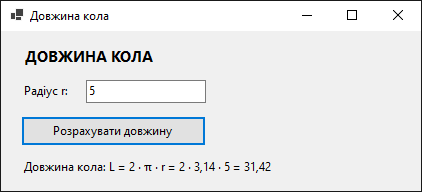

`Домашня робота №4`

## Віконний калькулятор формул

Мовою C# з використанням Windows Forms створити програму, яка за введеними користувачем даними обчислює **три формули** свого варіанта й виводить результат на форму.

### Вимоги

- для кожної формули — поля введення вхідних даних, кнопка розрахунку й напис (`Label`) для результату
- у результаті вивести **назву формули**, **проміжний розрахунок** і **відповідь**, наприклад: `Довжина кола: L = 2 · π · r = 2 · 3,14 · 5 = 31,42`
- результат округлювати до двох знаків після коми (`Math.Round(x, 2)`)
- елементам дати осмислені імена з префіксами: `txt...`, `btn...`, `lbl...`
- перевіряти некоректне введення поки не потрібно — це тема наступного уроку; дробові числа вводяться **через кому** (`2,5`)

### Формули

| № | Назва формули | Вхідні дані | Формула |
| :---- | :---- | :---- | :---- |
| **1** | Площа трикутника | a, h | $S = \dfrac{a \cdot h}{2}$ |
| **2** | Середнє арифметичне | x, y, z | $M = \dfrac{x + y + z}{3}$ |
| **3** | Периметр прямокутника | a, b | $P = 2 \cdot (a + b)$ |
| **4** | Густина | m, V | $\rho = \dfrac{m}{V}$ |
| **5** | Робота сили | F, s | $A = F \cdot s$ |
| **6** | Розрахунок відсотків | P, r | $S = P \cdot \dfrac{r}{100}$ |
| **7** | Периметр рівностороннього трикутника | a | $P = 3 \cdot a$ |
| **8** | Потужність електричного струму | U, I | $P = U \cdot I$ |
| **9** | Рівняння лінії | x, k, b | $y = k \cdot x + b$ |
| **10** | Час у дорозі | s, v | $t = \dfrac{s}{v}$ |
| **11** | Тиск | F, S | $p = \dfrac{F}{S}$ |
| **12** | Рівняння стану ідеального газу | n, R, T, V | $p = \dfrac{n \cdot R \cdot T}{V}$ |

### Варіанти

> [!NOTE]
> Номер варіанта відповідає вашому номеру в списку групи. Якщо не знаєте свій номер — зверніться до викладача.

| Варіант | Формули | Варіант | Формули |
| :---- | :---- | :---- | :---- |
| **1** | 1, 5, 9 | **7** | 3, 8, 9 |
| **2** | 2, 6, 10 | **8** | 4, 5, 10 |
| **3** | 3, 7, 11 | **9** | 1, 7, 9 |
| **4** | 4, 8, 12 | **10** | 2, 8, 11 |
| **5** | 1, 6, 11 | **11** | 3, 5, 12 |
| **6** | 2, 7, 12 | **12** | 4, 6, 10 |

### Як здати

Один із варіантів:

- **архів з проєктом** Visual Studio — уся папка проєкту, а не лише `.sln`-файл
- **скриншоти** форми й виконання програми та **текст коду** — окремими файлами або в документі Word

---

### Приклад виконання

> Формула довжини кола $L = 2 \cdot \pi \cdot r$, вхідні дані — r.



<details>
<summary><b>📄 Form1.cs</b></summary>

```C#
public partial class Form1 : Form
{
    public Form1()
    {
        InitializeComponent();
    }

    private void btnCalculate_Click(object sender, EventArgs e)
    {
        double radius = Convert.ToDouble(txtRadius.Text);
        double length = Math.Round(2 * Math.PI * radius, 2);

        lblResult.Text = $"Довжина кола: L = 2 · π · r = 2 · 3,14 · {radius} = {length}";
    }
}
```

</details>

Елементи форми: `lblTitle`, `lblRadius`, `txtRadius`, `btnCalculate` (обробник `Click` — подвійним клацанням) і `lblResult`. `Convert.ToDouble(...)` перетворює введений текст на число.

---

### 📖 Пов'язані уроки

- [7. Вступ до Windows Forms](/Lessons/7_Intro_WinForms.md) — форма, елементи керування, властивості
- [8. Події та базові елементи керування](/Lessons/8_Events_Controls.md) — кнопки, обробник `Click`, `TextBox`, `Label`, іменування

---
<p align="center">
    У MyStat потрібно завантажити код додатку та скриншоти його тестування.
</p>

---
