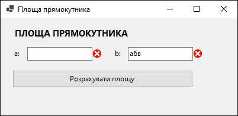
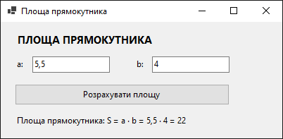

`Домашня робота №5`

## Перевірка введення в калькуляторі формул

Доопрацювати програму з [домашньої роботи №4](/Homeworks/Homework_4.md): додати до кожної з трьох формул свого варіанта **перевірку введених даних**. Програма не повинна аварійно зупинятися за жодного введення.

### Вимоги

- замінити `Convert.ToDouble(...)` на **`double.TryParse(...)`**
- для **кожного поля** перевіряти:
  - поле не порожнє → інакше помилка «Введіть значення»
  - введено число → інакше «Введіть число, наприклад 2,5»
  - значення в допустимих межах (див. таблицю нижче) → інакше повідомлення з правилом, наприклад «Значення має бути більшим за 0»
- помилку показувати **біля поля** за допомогою `ErrorProvider`; коли поле виправлено — позначку прибирати
- під час натискання кнопки перевіряти **всі** поля формули й показувати **всі** помилки одразу
- якщо є хоча б одна помилка — результат не рахувати, а напис з результатом очищати

### Перевірки для кожної формули

| № | Формула | Перевірки меж |
| :---- | :---- | :---- |
| **1** | Площа трикутника $S = \dfrac{a \cdot h}{2}$ | $a > 0$, $h > 0$ |
| **2** | Середнє арифметичне $M = \dfrac{x + y + z}{3}$ | лише «не порожнє» та «число» — будь-які числа |
| **3** | Периметр прямокутника $P = 2 \cdot (a + b)$ | $a > 0$, $b > 0$ |
| **4** | Густина $\rho = \dfrac{m}{V}$ | $m > 0$, $V > 0$ (ділення на нуль) |
| **5** | Робота сили $A = F \cdot s$ | $F \ge 0$, $s \ge 0$ |
| **6** | Розрахунок відсотків $S = P \cdot \dfrac{r}{100}$ | $P \ge 0$, $0 \le r \le 100$ |
| **7** | Периметр рівностороннього трикутника $P = 3 \cdot a$ | $a > 0$ |
| **8** | Потужність електричного струму $P = U \cdot I$ | $U \ge 0$, $I \ge 0$ |
| **9** | Рівняння лінії $y = k \cdot x + b$ | лише «не порожнє» та «число» — будь-які числа |
| **10** | Час у дорозі $t = \dfrac{s}{v}$ | $s \ge 0$, $v > 0$ (ділення на нуль) |
| **11** | Тиск $p = \dfrac{F}{S}$ | $F \ge 0$, $S > 0$ (ділення на нуль) |
| **12** | Рівняння стану ідеального газу $p = \dfrac{n \cdot R \cdot T}{V}$ | $n > 0$, $R > 0$, $T > 0$, $V > 0$ |

### Варіанти

> [!NOTE]
> Варіанти — ті самі, що в домашній роботі №4: номер варіанта відповідає вашому номеру в списку групи. Якщо не знаєте свій номер — зверніться до викладача.

| Варіант | Формули | Варіант | Формули |
| :---- | :---- | :---- | :---- |
| **1** | 1, 5, 9 | **7** | 3, 8, 9 |
| **2** | 2, 6, 10 | **8** | 4, 5, 10 |
| **3** | 3, 7, 11 | **9** | 1, 7, 9 |
| **4** | 4, 8, 12 | **10** | 2, 8, 11 |
| **5** | 1, 6, 11 | **11** | 3, 5, 12 |
| **6** | 2, 7, 12 | **12** | 4, 6, 10 |

### Як здати

Один із варіантів:

- **архів з проєктом** Visual Studio — уся папка проєкту
- **текст коду** та **скриншоти** — окремими файлами або в документі Word

Скриншоти мають показувати **кожну перевірку** для кожної з трьох формул:

1. порожнє поле
2. текст замість числа
3. значення поза межами (для кожного обмеження з таблиці)
4. правильні дані та результат

На скриншотах з помилками наведіть курсор на значок помилки, щоб було видно її текст.

---

### Приклад виконання

> Площа прямокутника $S = a \cdot b$, перевірки: $a > 0$, $b > 0$.

Обидва поля перевіряються одночасно — помилки видно біля кожного:



Правильні дані:



<details>
<summary><b>📄 Form1.cs</b></summary>

```C#
public partial class Form1 : Form
{
    public Form1()
    {
        InitializeComponent();
    }

    private void btnCalculate_Click(object sender, EventArgs e)
    {
        // Перевіряємо ОБИДВА поля — щоб користувач одразу побачив усі помилки
        bool aOk = ReadPositive(txtA, out double a);
        bool bOk = ReadPositive(txtB, out double b);

        if (!aOk || !bOk)
        {
            lblResult.Text = "";
            return;
        }

        double area = Math.Round(a * b, 2);
        lblResult.Text = $"Площа прямокутника: S = a · b = {a} · {b} = {area}";
    }

    // Перевіряє поле: не порожнє, число, більше за нуль. Показує або прибирає позначку помилки.
    private bool ReadPositive(TextBox field, out double value)
    {
        if (string.IsNullOrWhiteSpace(field.Text))
        {
            errorProvider1.SetError(field, "Введіть значення");
            value = 0;
            return false;
        }
        if (!double.TryParse(field.Text, out value))
        {
            errorProvider1.SetError(field, "Введіть число, наприклад 2,5");
            return false;
        }
        if (value <= 0)
        {
            errorProvider1.SetError(field, "Значення має бути більшим за 0");
            return false;
        }

        errorProvider1.SetError(field, "");
        return true;
    }
}
```

</details>

Метод `ReadPositive` повертає `true` або `false` — як `TryParse`, а саме число віддає через `out`. Обидва поля перевіряються **до** умови `if`, тому позначки з'являються біля всіх полів з помилками, а не лише біля першого. Для інших обмежень (`≥ 0`, від 0 до 100) можна написати схожі методи або додати в метод параметри з межами.

---

### 📖 Пов'язані уроки

- [9. Введення та перевірка даних](/Lessons/9_Input_Validation.md) — `TryParse`, перевірка діапазону, `ErrorProvider`
- [8. Події та базові елементи керування](/Lessons/8_Events_Controls.md) — обробники, `TextBox`, `Label`

---
<p align="center">
    У MyStat потрібно завантажити код додатку та скриншоти його тестування.
</p>

---
