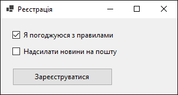
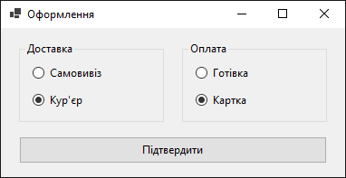
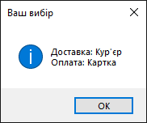
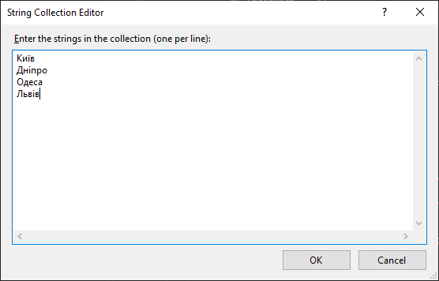
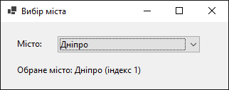
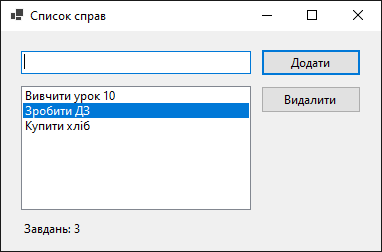
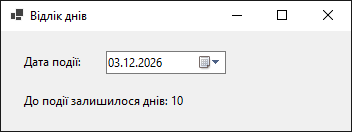
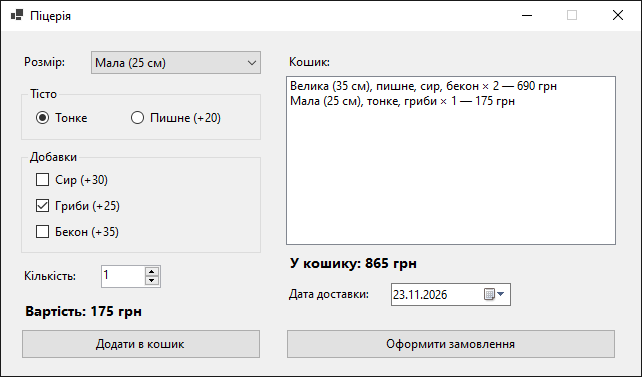
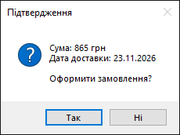
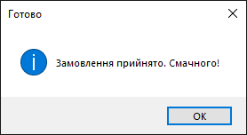

# 10. Елементи вибору

![block-badge] ![lang-badge]

## Зміст
1. [Навіщо елементи вибору](#навіщо-елементи-вибору)
2. [CheckBox](#checkbox)
3. [RadioButton і GroupBox](#radiobutton-і-groupbox)
4. [ComboBox](#combobox)
5. [ListBox](#listbox)
6. [DateTimePicker](#datetimepicker)
7. [Повний приклад](#повний-приклад)
8. [Порівняння елементів вибору](#порівняння-елементів-вибору)
9. [Елементи вибору в реальних програмах](#елементи-вибору-в-реальних-програмах)
10. [Підсумок](#підсумок)
11. [Запитання для самоперевірки](#запитання-для-самоперевірки)
12. [Довідкові матеріали](#довідкові-матеріали)

---

## Навіщо елементи вибору

В уроці 9 ми навчилися перевіряти введений текст. Але найпростіше — взагалі **не просити** вводити, коли відповідь треба обрати з відомих варіантів. Уявіть поле «Місто», де користувачі пишуть `Київ`, `київ`, `Kyiv`, `м. Київ`… Перевірити все це майже неможливо. А якщо дати список міст, помилитися не вийде.

> **Елементи вибору** (selection controls) — елементи керування, у яких користувач _не вводить, а обирає_ значення: позначає пункт, перемикає варіант, обирає зі списку чи календаря.

**Навіщо вони потрібні:**

- менше помилок: обрати можна лише допустиме значення
- швидше для користувача: клацнути простіше, ніж набирати
- менше коду перевірок у програмі
- одразу видно всі можливі варіанти

| Елемент | Для чого |
| :---- | :---- |
| **`CheckBox`** (прапорець) | Так/ні; кілька незалежних опцій |
| **`RadioButton`** (перемикач) | Один варіант з кількох |
| **`ComboBox`** (випадний список) | Один варіант з довгого списку |
| **`ListBox`** (список) | Перелік елементів, які видно одразу |
| **`DateTimePicker`** | Дата або час |

---

## CheckBox

> **`CheckBox`** (прапорець) — елемент із квадратиком, який користувач позначає або знімає. Кожен прапорець **незалежний** від інших.

| Властивість / подія | Що означає |
| :---- | :---- |
| **`Checked`** | `true`, якщо прапорець позначено |
| **`Text`** | Підпис біля квадратика |
| **`CheckedChanged`** | Подія: стан прапорця змінився |

На формі «Реєстрація» — прапорці `chkAgree` («Я погоджуюся з правилами») і `chkNews`, а також кнопка `btnRegister` з `Enabled = false`:

```C#
private void chkAgree_CheckedChanged(object sender, EventArgs e)
{
    btnRegister.Enabled = chkAgree.Checked;
}
```

Результат роботи після позначення прапорця «Я погоджуюся з правилами»:



Один рядок — і кнопка вмикається лише тоді, коли користувач погодився з правилами. Прапорець «Надсилати новини» на неї не впливає: прапорці незалежні.

---

## RadioButton і GroupBox

> **`RadioButton`** (перемикач) — елемент із кружечком для вибору **одного** варіанта з кількох. Коли користувач обирає один перемикач, інші в тій самій групі автоматично знімаються.

Але що, якщо на формі два незалежні вибори — спосіб доставки і спосіб оплати? Для цього перемикачі розкладають по **контейнерах**.

> **`GroupBox`** — рамка з підписом, яка _групує_ елементи. Перемикачі всередині однієї рамки утворюють окрему групу.

Спершу перетягніть на форму `GroupBox`, задайте йому `Text`, а потім перетягуйте перемикачі **всередину** рамки:

| Контейнер | Перемикачі (`Name` — `Text`) |
| :---- | :---- |
| **`grpDelivery`** «Доставка» | `rbPickup` — Самовивіз (`Checked = true`), `rbCourier` — Кур'єр |
| **`grpPayment`** «Оплата» | `rbCash` — Готівка (`Checked = true`), `rbCard` — Картка |

```C#
private void btnConfirm_Click(object sender, EventArgs e)
{
    string delivery = "Самовивіз";
    if (rbCourier.Checked)
    {
        delivery = "Кур'єр";
    }

    string payment = "Готівка";
    if (rbCard.Checked)
    {
        payment = "Картка";
    }

    MessageBox.Show($"Доставка: {delivery}\nОплата: {payment}", "Ваш вибір",
        MessageBoxButtons.OK, MessageBoxIcon.Information);
}
```

Результат роботи після вибору кур'єра й оплати карткою:





Кожна рамка — окрема група: вибір у «Доставці» не знімає вибору в «Оплаті».

Зверніть увагу на `\n` у тексті повідомлення: це перехід на новий рядок, тому «Оплата» у вікні — на окремому рядку.

> [!TIP]
> **Порада:** завжди позначайте один перемикач у групі за замовчуванням (`Checked = true` у дизайнері). Інакше користувач може нічого не обрати, і програмі доведеться перевіряти ще й цей випадок.

> [!WARNING]
> **Часта плутанина:** подія `CheckedChanged` у перемикачів спрацьовує **двічі**: для того, що зняли, і для того, що обрали. Тому в її обробнику перевіряйте `Checked`, а не просто сам факт події. А ще простіше — як у прикладі вище: читати `Checked` тоді, коли значення справді потрібне (під час натискання кнопки).

---

## ComboBox

> **`ComboBox`** (випадний список) — поле, яке розгортається в список варіантів. Займає мало місця навіть тоді, коли варіантів десятки.

### Заповнення списку

Варіанти зберігаються у властивості **`Items`**. Заповнити її можна двома способами:

- **у дизайнері:** у вікні Properties знайдіть `Items`, натисніть `...` і введіть варіанти — кожен з нового рядка
- **у коді:** `cmbCity.Items.Add("Київ");`



### Головні властивості

| Властивість / подія | Що означає |
| :---- | :---- |
| **`Items`** | Колекція варіантів |
| **`SelectedIndex`** | Номер обраного варіанта, починаючи з `0`; `-1` — нічого не обрано |
| **`SelectedItem`** | Сам обраний варіант |
| **`Text`** | Текст у полі |
| **`DropDownStyle`** | `DropDown` — можна ввести свій текст; **`DropDownList`** — лише вибір зі списку |
| **`SelectedIndexChanged`** | Подія: обрано інший варіант |

На формі «Вибір міста» — `cmbCity` з `DropDownStyle = DropDownList` і напис `lblInfo`:

```C#
public partial class Form1 : Form
{
    public Form1()
    {
        InitializeComponent();

        cmbCity.Items.Add("Київ");
        cmbCity.Items.Add("Дніпро");
        cmbCity.Items.Add("Львів");
        cmbCity.Items.Add("Одеса");
        cmbCity.Items.Add("Харків");
        cmbCity.SelectedIndex = 1; // обраний за замовчуванням — «Дніпро»
    }

    private void cmbCity_SelectedIndexChanged(object sender, EventArgs e)
    {
        lblInfo.Text = $"Обране місто: {cmbCity.SelectedItem} (індекс {cmbCity.SelectedIndex})";
    }
}
```

Результат роботи:



Нумерація варіантів починається з нуля, як у масивах і `List<T>`: «Київ» — 0, «Дніпро» — 1. Присвоєння `SelectedIndex = 1` у конструкторі одразу викликає подію `SelectedIndexChanged` — обробник на неї вже підписав дизайнер у `InitializeComponent()`, тому напис заповнився сам.

> [!WARNING]
> **Часта помилка:** залишити `DropDownStyle = DropDown` (значення за замовчуванням). Тоді користувач може надрукувати в полі будь-що — і вся перевага списку зникає. Для вибору з фіксованих варіантів ставте **`DropDownList`**.

---

## ListBox

> **`ListBox`** (список) — прямокутник, у якому **одразу видно** кілька елементів. Підходить для переліків, які змінюються під час роботи програми: кошик, список справ, учасники.

| Властивість / метод | Що робить |
| :---- | :---- |
| **`Items.Add(x)`** | Додати елемент у кінець |
| **`Items.RemoveAt(i)`** | Видалити елемент за номером |
| **`Items.Clear()`** | Очистити список |
| **`Items.Count`** | Кількість елементів |
| **`SelectedIndex`**, **`SelectedItem`** | Обраний елемент (`-1` — нічого не обрано) |
| **`SelectionMode`** | `One` — один елемент; `MultiExtended` — кілька, з `Ctrl` і `Shift` (усі обрані — у `SelectedItems`) |

### Приклад: список справ

На формі «Список справ» — поле `txtTask`, кнопки `btnAdd` і `btnRemove`, список `lstTasks` і напис `lblCount`:

```C#
public partial class Form1 : Form
{
    public Form1()
    {
        InitializeComponent();
    }

    private void btnAdd_Click(object sender, EventArgs e)
    {
        string task = txtTask.Text.Trim();
        if (task.Length == 0)
        {
            MessageBox.Show("Введіть текст завдання.", "Порожнє завдання",
                MessageBoxButtons.OK, MessageBoxIcon.Warning);
            return;
        }

        lstTasks.Items.Add(task);
        txtTask.Clear();
        txtTask.Focus();
        UpdateCount();
    }

    private void btnRemove_Click(object sender, EventArgs e)
    {
        if (lstTasks.SelectedIndex == -1)
        {
            MessageBox.Show("Спершу оберіть завдання у списку.", "Нічого не обрано",
                MessageBoxButtons.OK, MessageBoxIcon.Warning);
            return;
        }

        lstTasks.Items.RemoveAt(lstTasks.SelectedIndex);
        UpdateCount();
    }

    private void UpdateCount()
    {
        lblCount.Text = $"Завдань: {lstTasks.Items.Count}";
    }
}
```

Результат роботи після додавання трьох завдань і вибору другого:



Перед видаленням обов'язково перевіряємо `SelectedIndex == -1`: якщо нічого не обрано, `RemoveAt(-1)` згенерував би виняток.

---

## DateTimePicker

> **`DateTimePicker`** — поле для вибору **дати** (або часу) з календаря, що розгортається. Користувач не може ввести дату, якої не існує, на кшталт 31 лютого.

| Властивість / подія | Що означає |
| :---- | :---- |
| **`Value`** | Обрані дата й час (тип `DateTime`) |
| **`Format`** | `Long` — з назвою дня й місяця; **`Short`** — лише цифри, напр. `23.11.2026`; `Time` — лише час |
| **`MinDate`**, **`MaxDate`** | Найраніша й найпізніша дати, які можна обрати |
| **`ValueChanged`** | Подія: дату змінено |

### Трохи про DateTime

| Запис | Що повертає |
| :---- | :---- |
| **`DateTime.Today`** | Сьогоднішня дата (без часу) |
| **`DateTime.Now`** | Поточні дата й час |
| **`date.AddDays(7)`** | Дата через 7 днів |
| **`date.Date`** | Та сама дата без часу |
| **`(date1 - date2).Days`** | Різниця між датами в днях |

На формі «Відлік днів» — `dtpEvent` з `Format = Short` і напис `lblDays`:

```C#
public partial class Form1 : Form
{
    public Form1()
    {
        InitializeComponent();
        dtpEvent.MinDate = DateTime.Today; // минулі дати обрати не можна
    }

    private void dtpEvent_ValueChanged(object sender, EventArgs e)
    {
        int days = (dtpEvent.Value.Date - DateTime.Today).Days;
        lblDays.Text = $"До події залишилося днів: {days}";
    }
}
```

Результат роботи для дати через 10 днів:



Віднімання двох дат дає не число, а **проміжок часу** (тип `TimeSpan`), а вже його властивість `Days` — кількість днів. `.Date` відкидає час (у `Value` за замовчуванням — поточний момент), щоб різниця рахувалася в цілих днях.

Напис оновлюється лише після зміни дати: поки користувач нічого не обрав, він порожній.

> [!NOTE]
> **Зверніть увагу:** вигляд дати `DateTimePicker` бере з регіональних налаштувань Windows (формат дати). У форматі `Long` назви днів і місяців будуть мовою цих налаштувань. Формат `Short` складається лише з цифр, але порядок і роздільники теж залежать від регіону: з українськими налаштуваннями — `03.12.2026`, з американськими — `12/3/2026`. Так само працює й метод `ToShortDateString()`.

---

## Повний приклад

«Піцерія»: користувач обирає розмір, тісто й добавки, бачить вартість, додає піцу в кошик і оформлює замовлення з датою доставки. Тут працюють усі елементи вибору, а також `NumericUpDown` з уроку 9.

### Елементи форми

| Елемент | `Name` | Властивості |
| :---- | :---- | :---- |
| **ComboBox** | `cmbSize` | `DropDownStyle`: `DropDownList` |
| **GroupBox** «Тісто» | `grpDough` | усередині: `rbThin` «Тонке» (`Checked = true`), `rbThick` «Пишне (+20)» |
| **GroupBox** «Добавки» | `grpToppings` | усередині: `chkCheese` «Сир (+30)», `chkMushrooms` «Гриби (+25)», `chkBacon` «Бекон (+35)» |
| **NumericUpDown** | `nudQuantity` | `Minimum`: 1, `Maximum`: 10 |
| **Label** | `lblPrice` | вартість поточної піци |
| **Button** | `btnAdd` | «Додати в кошик» |
| **ListBox** | `lstCart` | кошик |
| **Label** | `lblCartTotal` | `Text`: `У кошику: 0 грн` |
| **DateTimePicker** | `dtpDelivery` | `Format`: `Short` |
| **Button** | `btnOrder` | «Оформити замовлення» |

Підписка на `Click` обох кнопок — подвійним клацанням. На зміни параметрів піци підписуємося в коді — одним спільним обробником (урок 8).

#### `Form1.cs` — код форми

```C#
public partial class Form1 : Form
{
    private int[] sizePrices = { 150, 200, 260 }; // масив: ціни розмірів у тому ж порядку, що й варіанти cmbSize
    private int cartTotal;                         // сума всіх позицій у кошику

    public Form1()
    {
        InitializeComponent();

        cmbSize.Items.Add("Мала (25 см)");
        cmbSize.Items.Add("Середня (30 см)");
        cmbSize.Items.Add("Велика (35 см)");
        cmbSize.SelectedIndex = 1;

        dtpDelivery.MinDate = DateTime.Today;

        // Будь-яка зміна параметрів піци — перерахувати вартість
        cmbSize.SelectedIndexChanged += Option_Changed;
        rbThin.CheckedChanged += Option_Changed;
        rbThick.CheckedChanged += Option_Changed;
        chkCheese.CheckedChanged += Option_Changed;
        chkMushrooms.CheckedChanged += Option_Changed;
        chkBacon.CheckedChanged += Option_Changed;
        nudQuantity.ValueChanged += Option_Changed;

        UpdatePrice();
    }

    private void Option_Changed(object? sender, EventArgs e)
    {
        UpdatePrice();
    }

    // Вартість однієї піци з урахуванням усіх параметрів
    private int CalculatePizzaPrice()
    {
        int price = sizePrices[cmbSize.SelectedIndex];
        if (rbThick.Checked)
        {
            price += 20;
        }
        if (chkCheese.Checked)
        {
            price += 30;
        }
        if (chkMushrooms.Checked)
        {
            price += 25;
        }
        if (chkBacon.Checked)
        {
            price += 35;
        }
        return price;
    }

    private void UpdatePrice()
    {
        int total = CalculatePizzaPrice() * (int)nudQuantity.Value;
        lblPrice.Text = $"Вартість: {total} грн";
    }

    private void btnAdd_Click(object sender, EventArgs e)
    {
        string dough = "тонке";
        if (rbThick.Checked)
        {
            dough = "пишне";
        }

        string toppings = "";
        if (chkCheese.Checked)
        {
            toppings += ", сир";
        }
        if (chkMushrooms.Checked)
        {
            toppings += ", гриби";
        }
        if (chkBacon.Checked)
        {
            toppings += ", бекон";
        }

        int quantity = (int)nudQuantity.Value;
        int total = CalculatePizzaPrice() * quantity;

        lstCart.Items.Add($"{cmbSize.Text}, {dough}{toppings} × {quantity} — {total} грн");
        cartTotal += total;
        lblCartTotal.Text = $"У кошику: {cartTotal} грн";
    }

    private void btnOrder_Click(object sender, EventArgs e)
    {
        if (lstCart.Items.Count == 0)
        {
            MessageBox.Show("Кошик порожній. Додайте хоча б одну піцу.", "Замовлення",
                MessageBoxButtons.OK, MessageBoxIcon.Warning);
            return;
        }

        DialogResult result = MessageBox.Show(
            $"Сума: {cartTotal} грн\nДата доставки: {dtpDelivery.Value.ToShortDateString()}\n\nОформити замовлення?",
            "Підтвердження", MessageBoxButtons.YesNo, MessageBoxIcon.Question);

        if (result == DialogResult.Yes)
        {
            MessageBox.Show("Замовлення прийнято. Смачного!", "Готово",
                MessageBoxButtons.OK, MessageBoxIcon.Information);
            lstCart.Items.Clear();
            cartTotal = 0;
            lblCartTotal.Text = "У кошику: 0 грн";
        }
    }
}
```

Результат роботи після додавання двох позицій у кошик:



Після натискання «Оформити замовлення»:





**Що тут варто помітити:**

- ціни розмірів зберігаються в масиві `sizePrices` у тому ж порядку, що й варіанти в `cmbSize`, — тому ціну можна взяти за `SelectedIndex`
- один обробник `Option_Changed` підписаний на події **семи** різних елементів — вартість оновлюється після будь-якої зміни
- `cmbSize.Text` у `DropDownList` — це текст обраного варіанта
- `cartTotal` — поле форми: воно зберігає суму кошика між натисканнями кнопок
- у конструкторі `cmbSize.SelectedIndex = 1` стоїть **до** підписки на події — тому вперше вартість рахуємо вручну викликом `UpdatePrice()`
- перемикачі тіста викликають `Option_Changed` двічі (про це — у розділі про `RadioButton`) — тут це не страшно: повторний перерахунок дає той самий результат

> [!IMPORTANT]
> **Ключова ідея:** у формі немає жодного поля для вільного введення тексту — тож і перевіряти майже нічого (лише чи не порожній кошик). Правильно підібрані елементи вибору часто роблять програму надійнішою, ніж перевірки введеного тексту.

---

## Порівняння елементів вибору

| Ситуація | Елемент |
| :---- | :---- |
| **Так / ні, увімкнути / вимкнути** | `CheckBox` |
| **Кілька незалежних опцій** (добавки, налаштування) | Кілька `CheckBox` |
| **Один варіант з 2–5**, усі мають бути на виду | `RadioButton` у `GroupBox` |
| **Один варіант із довгого списку** (міста, країни, розміри) | `ComboBox` з `DropDownList` |
| **Перелік, що змінюється під час роботи** (кошик, справи) | `ListBox` |
| **Дата або час** | `DateTimePicker` |
| **Число в межах** | `NumericUpDown` (урок 9) |

**Головна різниця** — між `CheckBox` і `RadioButton`: прапорці незалежні (можна позначити скільки завгодно), а перемикачі в групі взаємовиключні (рівно один). Між `RadioButton` і `ComboBox` — у кількості варіантів і місці: перемикачі показують усе одразу, список ховає варіанти й займає один рядок.

---

## Елементи вибору в реальних програмах

| Де | Що використовується |
| :---- | :---- |
| **Налаштування Windows** | Вимикачі «Увімк./Вимк.» (toggle switch) — сучасний вигляд прапорця; випадні списки мови й часового поясу |
| **Встановлення програм** | Прапорці «Створити ярлик на робочому столі», перемикачі «Повне / Вибіркове встановлення» |
| **Квитки на потяг чи літак** | Календар дати поїздки, випадні списки міст, перемикачі класу |
| **Інтернет-магазини** | Прапорці фільтрів (бренд, ціна), випадний список сортування, кошик-список |

Вигляд цих елементів у різних програмах відрізняється, але принципи ті самі, що й у Windows Forms: прапорець — незалежне «так/ні», перемикач — один з кількох, список — вибір із переліку.

---

## Підсумок

- **`CheckBox`** — незалежне «так/ні» (`Checked`, подія `CheckedChanged`)
- **`RadioButton`** — один варіант із групи; групи створюють контейнером **`GroupBox`**, а один перемикач варто позначати за замовчуванням
- **`ComboBox`** — випадний список: варіанти в `Items`, обране — у `SelectedIndex` / `SelectedItem`; для вибору лише зі списку — `DropDownStyle = DropDownList`
- **`ListBox`** — видимий список, елементи якого додають і видаляють у коді (`Items.Add`, `Items.RemoveAt`); `SelectedIndex == -1` — нічого не обрано
- **`DateTimePicker`** — вибір дати (`Value` типу `DateTime`, `MinDate` / `MaxDate`); різниця дат — `TimeSpan` з властивістю `Days`

---

## Запитання для самоперевірки

1. Чим елементи вибору кращі за поле для введення тексту?
2. Чим відрізняються `CheckBox` і `RadioButton`? Наведіть приклад для кожного.
3. Як зробити на одній формі дві незалежні групи перемикачів?
4. Що означає `SelectedIndex = -1` у `ComboBox` чи `ListBox`?
5. Навіщо встановлювати `DropDownStyle = DropDownList`?
6. Як додати, видалити й порахувати елементи `ListBox`?
7. Чому перед `lstTasks.Items.RemoveAt(lstTasks.SelectedIndex)` потрібна перевірка?
8. Як заборонити обирати в `DateTimePicker` минулі дати? Як порахувати кількість днів до обраної дати?
9. Навіщо в повному прикладі один обробник підписано на події кількох елементів?

---

## Довідкові матеріали

- [Прапорець (інтерфейс)](https://uk.wikipedia.org/wiki/%D0%9F%D1%80%D0%B0%D0%BF%D0%BE%D1%80%D0%B5%D1%86%D1%8C_(%D1%96%D0%BD%D1%82%D0%B5%D1%80%D1%84%D0%B5%D0%B9%D1%81)) — `uk.wikipedia.org`
- [Радіокнопка](https://uk.wikipedia.org/wiki/%D0%A0%D0%B0%D0%B4%D1%96%D0%BE%D0%BA%D0%BD%D0%BE%D0%BF%D0%BA%D0%B0) — `uk.wikipedia.org`
- [Випадний список](https://uk.wikipedia.org/wiki/%D0%92%D0%B8%D0%BF%D0%B0%D0%B4%D0%BD%D0%B8%D0%B9_%D1%81%D0%BF%D0%B8%D1%81%D0%BE%D0%BA) — `uk.wikipedia.org`
- [ComboBox Class](https://learn.microsoft.com/dotnet/api/system.windows.forms.combobox) — `learn.microsoft.com`
- [ListBox Class](https://learn.microsoft.com/dotnet/api/system.windows.forms.listbox) — `learn.microsoft.com`
- [DateTimePicker Class](https://learn.microsoft.com/dotnet/api/system.windows.forms.datetimepicker) — `learn.microsoft.com`
- [DateTime Struct](https://learn.microsoft.com/dotnet/api/system.datetime) — `learn.microsoft.com`

---
[block-badge]:https://img.shields.io/badge/Windows%20Forms-purple?style=flat
[lang-badge]:https://img.shields.io/badge/C%23-blue?style=flat&logo=dotnet
