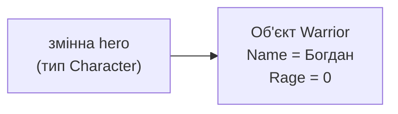
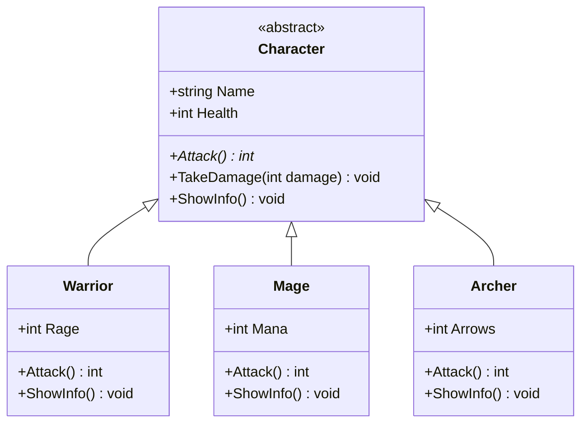

# 6. Поліморфізм: virtual, override та абстрактні класи

![block-badge] ![lang-badge]

## Зміст
1. [Проблема: загін персонажів](#проблема-загін-персонажів)
2. [Що таке поліморфізм](#що-таке-поліморфізм)
3. [Змінна базового типу](#змінна-базового-типу)
4. [Віртуальні методи: virtual і override](#віртуальні-методи-virtual-і-override)
5. [Як C# обирає метод](#як-c-обирає-метод)
6. [override проти new](#override-проти-new)
7. [Абстрактні класи та методи](#абстрактні-класи-та-методи)
8. [Перевизначення ToString](#перевизначення-tostring)
9. [Перевірка типу: is](#перевірка-типу-is)
10. [Повний приклад](#повний-приклад)
11. [Порівняння способів оголошення методів](#порівняння-способів-оголошення-методів)
12. [Поліморфізм у реальних програмах](#поліморфізм-у-реальних-програмах)
13. [Підсумок](#підсумок)
14. [Запитання для самоперевірки](#запитання-для-самоперевірки)
15. [Довідкові матеріали](#довідкові-матеріали)

---

## Проблема: загін персонажів

Продовжуємо рольову гру з уроку 5. У нас є базовий клас `Character` і похідні `Warrior`, `Mage`, `Archer`. Тепер хочемо зібрати з них **загін** і наказати всім атакувати троля:

```C#
Warrior warrior = new Warrior("Богдан");
Mage mage = new Mage("Злата");
Archer archer = new Archer("Остап", 2);
// troll — противник, якого атакує загін

// У кожного типу — своя назва атаки
troll.TakeDamage(warrior.Hit());
troll.TakeDamage(mage.Fireball());
troll.TakeDamage(archer.Shoot());
```

Поки персонажів троє, це терпимо. Але:

- кожен тип персонажа доводиться обробляти **окремим рядком** — навіть якщо зібрати їх в один список, у циклі нема чого викликати: спільного методу атаки немає
- додали цілителя — переписуємо код бою; додали ще десять типів — десять нових рядків у кожному місці, де персонажі атакують
- в уроці 5 ми не змогли написати у `Warrior` власний `ShowInfo()`: компілятор попереджав про приховування методу (`CS0108`)

Хотілося б, щоб код бою виглядав так: «для кожного персонажа в загоні — **атакуй**», а кожен персонаж сам знав, _як саме_ він атакує.

---

## Що таке поліморфізм

> **Поліморфізм** (polymorphism, від грец. «багато форм») — принцип ООП, за якого _однаковий виклик методу призводить до різної поведінки_ залежно від того, яким є об'єкт насправді.

Аналогія — команда «Атакуй!» на полі бою. Її отримують усі, але воїн б'є мечем, маг кидає вогняну кулю, а лучник стріляє з лука. Командир не мусить знати подробиць — достатньо того, що кожен боєць **уміє атакувати**.

Поліморфізм спирається на наслідування: саме тому, що воїн, маг і лучник — **персонажі**, з ними можна працювати однаково.

**Навіщо потрібен поліморфізм:**

- код пишеться для базового типу, а працює з усіма похідними
- нові типи додаються без змін у коді, який ними користується
- зникають ланцюжки «якщо воїн — зроби так, якщо маг — інакше»
- кожен клас сам відповідає за свою поведінку

---

## Змінна базового типу

Перший крок до поліморфізму — те, що свідомо не використовувалося в уроці 5: змінна типу базового класу може зберігати **об'єкт похідного класу**.

```C#
Character hero = new Warrior("Богдан");
hero.ShowInfo();
```

Результат роботи:

```text
Богдан, рівень 1, здоров'я 120/120
```

Тут класи поки такі самі, як в уроці 5: `ShowInfo()` — звичайний метод `Character`.

Такий запис дозволений, бо воїн **є** персонажем (зв'язок is-a). Навпаки — не можна: не кожен персонаж є воїном.



На схемі: змінна має тип `Character`, але посилається на справжній об'єкт `Warrior` — з усіма його полями.

### Що видно через таку змінну

Змінна «знає» лише те, що є в типі `Character`. Хоча в об'єкта є лють, звернутися до неї через `hero` не вийде:

```C#
Console.WriteLine(hero.Rage); // помилка компіляції
```

Помилка компіляції:

```text
error CS1061: 'Character' does not contain a definition for 'Rage' and no accessible extension method 'Rage' accepting a first argument of type 'Character' could be found (are you missing a using directive or an assembly reference?)
```

Компілятор перевіряє код за **типом змінної**: у класі `Character` властивості `Rage` немає.

### Список персонажів

Зате тепер усіх персонажів можна тримати в одному списку:

```C#
List<Character> party = new List<Character>();
party.Add(new Warrior("Богдан"));
party.Add(new Mage("Злата"));
party.Add(new Archer("Остап", 2));
```

Залишилося навчити кожного персонажа атакувати **через спільний метод** базового класу.

---

## Віртуальні методи: virtual і override

> **Віртуальний метод** (virtual method) — метод базового класу, позначений словом `virtual`, який _похідні класи можуть перевизначити_ — замінити своєю реалізацією за допомогою слова `override`.

Щоб приклад був компактнішим, ми трохи спростили класи з уроку 5: прибрали `LevelUp()`, `HealSelf()` і `CollectArrows()`, а окремі атаки `Hit()`, `PowerStrike()`, `Fireball()` і `Shoot()` замінимо одним спільним методом `Attack()`.

Додамо його в `Character`. Він описує поведінку «за замовчуванням»:

```C#
// У класі Character
public virtual int Attack()
{
    Console.WriteLine($"{Name} б'є кулаком");
    return 5;
}
```

А кожен похідний клас перевизначає його по-своєму. Воїн об'єднує в одному методі звичайний і потужний удари з уроку 5:

```C#
// У класі Warrior
public override int Attack()
{
    if (Rage >= 40)
    {
        Rage -= 40;
        Console.WriteLine($"{Name} завдає потужного удару!");
        return 25 + Level * 5;
    }
    Rage += 20;
    Console.WriteLine($"{Name} б'є мечем (лють: {Rage})");
    return 10;
}
```

```C#
// У класі Mage
public override int Attack()
{
    if (Mana < 30)
    {
        Console.WriteLine($"{Name} б'є посохом (мана скінчилася)");
        return 5;
    }
    Mana -= 30;
    Console.WriteLine($"{Name} кидає вогняну кулю (мана: {Mana})");
    return 35;
}
```

`Archer` перевизначає `Attack()` так само (повний код — у розділі «Повний приклад»). Тепер бій — це один цикл:

```C#
foreach (Character hero in party)
{
    int damage = hero.Attack();
    Console.WriteLine($"  шкода: {damage}");
}
```

Результат роботи:

```text
Богдан б'є мечем (лють: 20)
  шкода: 10
Злата кидає вогняну кулю (мана: 70)
  шкода: 35
Остап стріляє з лука (стріл: 1)
  шкода: 15
```

Рядок `hero.Attack()` один, а атаки — три різні. Це і є поліморфізм.

**Правила перевизначення:**

- у базовому класі метод позначається `virtual`, у похідному — `override`
- назва, параметри й тип результату мають **точно збігатися**
- модифікатор доступу теж однаковий (`public` → `public`)
- перевизначати не обов'язково: якщо похідний клас не має `override`, використовується версія базового класу

### base: доповнити, а не замінити

Часто похідному класу потрібна не зовсім нова поведінка, а **доповнена**. Наприклад, `ShowInfo()` воїна має показати все, що показує базовий клас, і ще лють. Для цього всередині `override` викликають версію базового класу через **`base.`**:

```C#
// У класі Character
public virtual void ShowInfo()
{
    Console.WriteLine($"{Name}, рівень {Level}, здоров'я {Health}/{MaxHealth}");
}
```

```C#
// У класі Warrior
public override void ShowInfo()
{
    base.ShowInfo(); // спершу — все, що виводить Character
    Console.WriteLine($"  лють: {Rage}");
}
```

Маг і лучник роблять так само для мани й стріл. Після атаки з попереднього прикладу:

```C#
foreach (Character hero in party)
{
    hero.ShowInfo();
}
```

Результат роботи:

```text
Богдан, рівень 1, здоров'я 120/120
  лють: 20
Злата, рівень 1, здоров'я 80/80
  мана: 70
Остап, рівень 1, здоров'я 90/90
  стріл: 1
```

Саме так розв'язується проблема з уроку 5: метод з тим самим ім'ям у похідному класі не викликає попередження, якщо базовий метод `virtual`, а похідний — `override`.

> [!WARNING]
> **Часта помилка:** написати `override` для методу, який у базовому класі **не** позначений `virtual`.
>
> Помилка компіляції:
> ```text
> error CS0506: 'Warrior.ShowInfo()': cannot override inherited member 'Character.ShowInfo()' because it is not marked virtual, abstract, or override
> ```
> Базовий клас сам вирішує, яку поведінку дозволено змінювати: перевизначити можна лише `virtual`-метод.

---

## Як C# обирає метод

Повернімося до змінної `Character hero = new Warrior("Богдан")`. Тип змінної — `Character`, а об'єкт — `Warrior`. Чий `Attack()` викличе `hero.Attack()`?

Правило для віртуальних методів: **викликається версія реального типу об'єкта**, а не типу змінної. Вибір методу відбувається під час роботи програми — кожного разу, коли метод викликається.

| Змінна | Реальний об'єкт | Виклик | Що спрацює |
| :---- | :---- | :---- | :---- |
| **`Warrior w`** | `Warrior` | `w.Attack()` | `Warrior.Attack()` |
| **`Character c`** | `Warrior` | `c.Attack()` | `Warrior.Attack()` — бо метод віртуальний |
| **`Character c`** | `Mage` | `c.Attack()` | `Mage.Attack()` |

> [!IMPORTANT]
> **Ключова ідея:** тип змінної визначає, **що** можна викликати (перевіряє компілятор). Реальний тип об'єкта визначає, **яка версія** віртуального методу виконається (вирішується під час роботи програми).

---

## override проти new

В уроці 5 компілятор у попередженні `CS0108` пропонував додати слово `new`, щоб «приховати» успадкований метод. Подивимося, чим приховування (`new`) відрізняється від перевизначення (`override`). Це окремий спрощений приклад, не пов'язаний з грою:

```C#
class Character
{
    public void Greet()
    {
        Console.WriteLine("Greet: я персонаж");
    }

    public virtual void Introduce()
    {
        Console.WriteLine("Introduce: я персонаж");
    }
}

class Warrior : Character
{
    public new void Greet() // приховування
    {
        Console.WriteLine("Greet: я воїн");
    }

    public override void Introduce() // перевизначення
    {
        Console.WriteLine("Introduce: я воїн");
    }
}
```

```C#
Warrior warrior = new Warrior();
Character character = warrior; // той самий об'єкт, змінна базового типу

warrior.Greet();
character.Greet();

warrior.Introduce();
character.Introduce();
```

Результат роботи:

```text
Greet: я воїн
Greet: я персонаж
Introduce: я воїн
Introduce: я воїн
```

Об'єкт **один**, але `Greet()` відповідає по-різному. З `new` метод обирається за **типом змінної**: через змінну `Character` викликається `Character.Greet()`. А `Introduce()` з `override` обирається за **реальним об'єктом** — тому завжди працює як у воїна.

> [!WARNING]
> **Часта плутанина:** `new` і `override` лише здаються схожими. `new` створює **новий, окремий** метод з тим самим ім'ям — і поліморфізм для нього не працює. Тому, щоб змінити поведінку успадкованого методу, майже завжди потрібні `virtual` + `override`, а не `new`.

---

## Абстрактні класи та методи

Подивіться на `Attack()` у базовому класі: «персонаж б'є кулаком». Але в нашій грі не буває «просто персонажа» — кожен є воїном, магом чи лучником. Та й вигадувати атаку «за замовчуванням» немає сенсу.

> **Абстрактний клас** (abstract class) — клас, позначений словом `abstract`, _об'єкти якого не можна створювати_: він існує лише як основа для похідних класів.
>
> **Абстрактний метод** (abstract method) — метод _без тіла_, який кожен неабстрактний похідний клас **зобов'язаний** перевизначити.

```C#
internal abstract class Character
{
    // поля, властивості, конструктор — як і раніше

    // Кожен персонаж атакує по-своєму — реалізація лише в похідних класах
    public abstract int Attack();

    // ...
}
```

Замість тіла методу — крапка з комою. `Character` лише заявляє: «кожен персонаж уміє атакувати», а _як саме_ — вирішують нащадки. Методи `Warrior`, `Mage` й `Archer` з `override` залишаються без змін.

### Що забороняє абстрактність

Створити «персонажа взагалі» тепер неможливо:

```C#
Character someone = new Character("Хтось", 100); // помилка компіляції
```

Помилка компіляції:

```text
error CS0144: Cannot create an instance of the abstract type or interface 'Character'
```

А якщо новий похідний клас забуде реалізувати абстрактний метод, компілятор нагадає й про це. Ось цілитель без `Attack()`:

```C#
internal class Healer : Character
{
    public Healer(string name) : base(name, 70)
    {
    }
}
```

Помилка компіляції:

```text
error CS0534: 'Healer' does not implement inherited abstract member 'Character.Attack()'
```

Тобто забути про атаку неможливо — це перевіряє компілятор, а не уважність програміста.

**Що може містити абстрактний клас:**

- звичайні поля, властивості й методи (`Name`, `Health`, `IsAlive`) — нащадки успадковують їх як завжди
- конструктор — його викликають нащадки через `base(...)`
- віртуальні методи з тілом (`ShowInfo()`, `TakeDamage()`) — нащадки можуть їх перевизначити
- абстрактні методи без тіла (`Attack()`) — нащадки **мусять** їх перевизначити

> [!TIP]
> **Порада:** робіть базовий клас абстрактним, коли він описує загальне поняття, якого «в чистому вигляді» не існує: персонаж, фігура, транспортний засіб, працівник.

На діаграмі класів абстрактний клас позначається `«abstract»`, а абстрактні методи — курсивом (у коді діаграми Mermaid курсив задає зірочка: `Attack()*`):



На діаграмі: `Character` абстрактний і лише оголошує `Attack()`, а кожен похідний клас надає власну реалізацію.

---

## Перевизначення ToString

В уроці 5 ми з'ясували, що всі класи успадковують від `object` метод `ToString()`. Він перетворює об'єкт на рядок — наприклад, коли об'єкт передають у `Console.WriteLine` або вставляють в інтерпольований рядок `$"..."`. За замовчуванням він повертає лише повну назву типу (разом із простором імен):

```C#
Warrior warrior = new Warrior("Богдан");
Console.WriteLine(warrior);
```

Результат роботи:

```text
Game.Models.Warrior
```

Користі мало. Але `ToString()` у класі `object` — віртуальний, тож його можна перевизначити:

```C#
// У класі Character
public override string ToString()
{
    return $"{Name} (рівень {Level})";
}
```

Результат роботи того самого коду:

```text
Богдан (рівень 1)
```

Перевизначення в `Character` спрацьовує для всіх нащадків. Тепер `Console.WriteLine(hero)` чи `$"Противник: {troll}"` виводять змістовний текст.

---

## Перевірка типу: is

Іноді через змінну базового типу все ж потрібен доступ до особливостей похідного класу — наприклад, показати лють воїна після бою. Для цього є оператор **`is`**:

```C#
foreach (Character hero in party)
{
    if (hero is Warrior warrior)
    {
        Console.WriteLine($"{warrior}, лють після бою: {warrior.Rage}");
    }
    else
    {
        Console.WriteLine(hero);
    }
}
```

Запис `hero is Warrior warrior` робить дві речі: перевіряє, чи об'єкт справді є воїном, і якщо так — створює змінну `warrior` типу `Warrior`, через яку доступна `Rage`. Якщо об'єкт інший — умова хибна, і змінною `warrior` скористатися не можна. Що виведе цей цикл — видно наприкінці «Повного прикладу».

> [!WARNING]
> **Часта помилка:** замінити поліморфізм ланцюжком перевірок:
> ```C#
> if (hero is Warrior w) { /* атака воїна */ }
> else if (hero is Mage m) { /* атака мага */ }
> else if (hero is Archer a) { /* атака лучника */ }
> ```
> Це та сама проблема, що й у першому розділі: кожен новий тип вимагає нової гілки. Якщо `is` трапляється часто — це сигнал, що в базовому класі бракує віртуального методу. `is` доречний для поодиноких випадків, коли справді потрібна особливість конкретного типу.

---

## Повний приклад

Зберемо загін, додамо **цілителя** й **монстра** — і подивимося, як поліморфізм дозволяє додавати нові типи, не змінюючи код бою. Воїн отримав ще одне перевизначення: броня зменшує шкоду, яку він отримує.

### Проєкт

```
Game/
├── Program.cs
└── Models/
    ├── Character.cs
    ├── Warrior.cs
    ├── Mage.cs
    ├── Archer.cs
    ├── Healer.cs
    └── Monster.cs
```

#### `Models/Character.cs` — абстрактний базовий клас

```C#
namespace Game.Models;

internal abstract class Character
{
    private int health;

    public Character(string name, int maxHealth)
    {
        Name = name;
        Level = 1;
        MaxHealth = maxHealth; // спершу максимум: властивість Health обмежує значення ним
        Health = maxHealth;
    }

    public string Name { get; }
    public int Level { get; protected set; }
    public int MaxHealth { get; protected set; }

    // Здоров'я завжди в межах від 0 до MaxHealth
    public int Health
    {
        get { return health; }
        protected set
        {
            if (value < 0)
            {
                health = 0;
            }
            else if (value > MaxHealth)
            {
                health = MaxHealth;
            }
            else
            {
                health = value;
            }
        }
    }

    public bool IsAlive
    {
        get { return Health > 0; }
    }

    // Кожен персонаж атакує по-своєму — реалізація лише в похідних класах
    public abstract int Attack();

    // Похідні класи можуть змінити, як персонаж отримує шкоду
    public virtual void TakeDamage(int damage)
    {
        Health -= damage;
        Console.WriteLine($"{Name} отримує {damage} шкоди, здоров'я: {Health}/{MaxHealth}");
        if (!IsAlive)
        {
            Console.WriteLine($"{Name} вибуває з бою");
        }
    }

    public virtual void ShowInfo()
    {
        Console.WriteLine($"{Name}, рівень {Level}, здоров'я {Health}/{MaxHealth}");
    }

    public override string ToString()
    {
        return $"{Name} (рівень {Level})";
    }
}
```

#### `Models/Warrior.cs` — воїн

```C#
namespace Game.Models;

internal class Warrior : Character
{
    public Warrior(string name) : base(name, 120)
    {
        Rage = 0;
    }

    public int Rage { get; private set; }

    public override int Attack()
    {
        if (Rage >= 40)
        {
            Rage -= 40;
            Console.WriteLine($"{Name} завдає потужного удару!");
            return 25 + Level * 5;
        }
        Rage += 20;
        Console.WriteLine($"{Name} б'є мечем (лють: {Rage})");
        return 10;
    }

    // Броня поглинає частину шкоди, решту обробляє базовий клас
    public override void TakeDamage(int damage)
    {
        int reduced = damage - 5;
        if (reduced < 0)
        {
            reduced = 0;
        }
        Console.WriteLine($"Броня поглинає {damage - reduced} шкоди");
        base.TakeDamage(reduced);
    }

    public override void ShowInfo()
    {
        base.ShowInfo();
        Console.WriteLine($"  лють: {Rage}");
    }
}
```

#### `Models/Mage.cs` — маг

```C#
namespace Game.Models;

internal class Mage : Character
{
    public Mage(string name) : base(name, 80)
    {
        Mana = 100;
    }

    public int Mana { get; private set; }

    public override int Attack()
    {
        if (Mana < 30)
        {
            Console.WriteLine($"{Name} б'є посохом (мана скінчилася)");
            return 5;
        }
        Mana -= 30;
        Console.WriteLine($"{Name} кидає вогняну кулю (мана: {Mana})");
        return 35;
    }

    public override void ShowInfo()
    {
        base.ShowInfo();
        Console.WriteLine($"  мана: {Mana}");
    }
}
```

#### `Models/Archer.cs` — лучник

```C#
namespace Game.Models;

internal class Archer : Character
{
    public Archer(string name, int arrows) : base(name, 90)
    {
        Arrows = arrows;
    }

    public int Arrows { get; private set; }

    public override int Attack()
    {
        if (Arrows == 0)
        {
            Console.WriteLine($"{Name} б'є кинджалом (стріли закінчилися)");
            return 7;
        }
        Arrows--;
        Console.WriteLine($"{Name} стріляє з лука (стріл: {Arrows})");
        return 15;
    }

    public override void ShowInfo()
    {
        base.ShowInfo();
        Console.WriteLine($"  стріл: {Arrows}");
    }
}
```

#### `Models/Healer.cs` — цілитель (новий тип)

```C#
namespace Game.Models;

internal class Healer : Character
{
    public Healer(string name) : base(name, 70)
    {
    }

    public override int Attack()
    {
        Console.WriteLine($"{Name} спрямовує святе світло");
        return 12;
    }
}
```

Цілитель не перевизначає `ShowInfo()` — для нього спрацює версія з `Character`.

#### `Models/Monster.cs` — монстр

```C#
namespace Game.Models;

internal class Monster : Character
{
    public Monster(string name, int maxHealth, int power) : base(name, maxHealth)
    {
        Power = power;
    }

    public int Power { get; }

    public override int Attack()
    {
        Console.WriteLine($"{Name} б'є палицею");
        return Power;
    }
}
```

#### `Program.cs` — бій

```C#
using Game.Models;

namespace Game;

class Program
{
    static void Main(string[] args)
    {
        List<Character> party = new List<Character>();
        party.Add(new Warrior("Богдан"));
        party.Add(new Mage("Злата"));
        party.Add(new Archer("Остап", 2));
        party.Add(new Healer("Мирослава"));

        Monster troll = new Monster("Троль", 150, 18);

        Console.WriteLine("Загін:");
        foreach (Character hero in party)
        {
            hero.ShowInfo();
        }
        Console.WriteLine($"Противник: {troll}");

        int round = 1;
        while (troll.IsAlive)
        {
            Console.WriteLine();
            Console.WriteLine($"--- Раунд {round} ---");
            foreach (Character hero in party)
            {
                troll.TakeDamage(hero.Attack());
                if (!troll.IsAlive)
                {
                    break;
                }
            }
            if (troll.IsAlive)
            {
                party[0].TakeDamage(troll.Attack()); // троль атакує першого в загоні
            }
            round++;
        }

        Console.WriteLine();
        Console.WriteLine("Перемога! Стан загону:");
        foreach (Character hero in party)
        {
            if (hero is Warrior warrior)
            {
                Console.WriteLine($"{warrior}, лють після бою: {warrior.Rage}");
            }
            else
            {
                Console.WriteLine(hero);
            }
        }
    }
}
```

Результат роботи:

```text
Загін:
Богдан, рівень 1, здоров'я 120/120
  лють: 0
Злата, рівень 1, здоров'я 80/80
  мана: 100
Остап, рівень 1, здоров'я 90/90
  стріл: 2
Мирослава, рівень 1, здоров'я 70/70
Противник: Троль (рівень 1)

--- Раунд 1 ---
Богдан б'є мечем (лють: 20)
Троль отримує 10 шкоди, здоров'я: 140/150
Злата кидає вогняну кулю (мана: 70)
Троль отримує 35 шкоди, здоров'я: 105/150
Остап стріляє з лука (стріл: 1)
Троль отримує 15 шкоди, здоров'я: 90/150
Мирослава спрямовує святе світло
Троль отримує 12 шкоди, здоров'я: 78/150
Троль б'є палицею
Броня поглинає 5 шкоди
Богдан отримує 13 шкоди, здоров'я: 107/120

--- Раунд 2 ---
Богдан б'є мечем (лють: 40)
Троль отримує 10 шкоди, здоров'я: 68/150
Злата кидає вогняну кулю (мана: 40)
Троль отримує 35 шкоди, здоров'я: 33/150
Остап стріляє з лука (стріл: 0)
Троль отримує 15 шкоди, здоров'я: 18/150
Мирослава спрямовує святе світло
Троль отримує 12 шкоди, здоров'я: 6/150
Троль б'є палицею
Броня поглинає 5 шкоди
Богдан отримує 13 шкоди, здоров'я: 94/120

--- Раунд 3 ---
Богдан завдає потужного удару!
Троль отримує 30 шкоди, здоров'я: 0/150
Троль вибуває з бою

Перемога! Стан загону:
Богдан (рівень 1), лють після бою: 0
Злата (рівень 1)
Остап (рівень 1)
Мирослава (рівень 1)
```

Подивіться, де працює поліморфізм:

| Виклик | Що відбувається |
| :---- | :---- |
| **`hero.ShowInfo()`** | Воїн, маг і лучник доповнюють вивід своїм рядком, цілитель використовує версію `Character` |
| **`hero.Attack()`** | У кожного персонажа — своя атака, а код бою один для всіх |
| **`party[0].TakeDamage(...)`** | Воїн перевизначив отримання шкоди: спершу спрацьовує броня, потім — `base.TakeDamage()` |
| **`$"Противник: {troll}"`** | Викликається перевизначений `ToString()` |

> [!IMPORTANT]
> **Ключова ідея:** щоб додати цілителя, ми написали лише клас `Healer` і один рядок `party.Add(...)`. Код бою не змінився жодним символом — він працює з будь-яким персонажем, бо звертається до нього через базовий тип.

---

## Порівняння способів оголошення методів

| Спосіб | Де пишеться | Чи має тіло | Чи можна перевизначити в нащадку | Чи обов'язково перевизначати |
| :---- | :---- | :---- | :---- | :---- |
| **Звичайний метод** | Будь-який клас | Так | Ні | — |
| **`virtual`** | Базовий клас | Так | Так, через `override` | Ні |
| **`abstract`** | Лише абстрактний клас | Ні | Так, через `override` | **Так** |
| **`override`** | Похідний клас | Так | Так (далі по ієрархії) | — |
| **`new`** | Похідний клас | Так | — (це новий окремий метод) | — |

**Головна різниця** — `virtual` _дозволяє_ нащадкам змінити поведінку, `abstract` _вимагає_ цього, а `override` її змінює; `new` лише ховає метод і ламає поліморфізм.

---

## Поліморфізм у реальних програмах

| Де | Як працює поліморфізм |
| :---- | :---- |
| **[Object.ToString()](https://learn.microsoft.com/dotnet/api/system.object.tostring)** | Віртуальний метод `object`, який перевизначають тисячі класів .NET: числа, дати, булеві значення — кожен «знає», як перетворити себе на рядок. А от `List<T>` його не перевизначає — тому виводить лише назву свого типу |
| **[Stream](https://learn.microsoft.com/dotnet/api/system.io.stream)** | Абстрактний клас для читання й запису даних. `FileStream` працює з файлом, `MemoryStream` — з пам'яттю, а код, написаний для `Stream`, працює з будь-яким із них |

Принцип усюди однаковий: бібліотека працює з базовим типом і викликає його віртуальні методи, а конкретну поведінку дають похідні класи — зокрема ті, які напише сам розробник.

---

## Підсумок

- **поліморфізм** — однаковий виклик методу дає різну поведінку залежно від реального типу об'єкта
- змінна базового типу може зберігати об'єкт похідного класу; через неї доступні лише члени базового типу
- `virtual` у базовому класі дозволяє перевизначити метод, `override` у похідному — перевизначає його; `base.Метод()` викликає версію базового класу
- об'єкт **абстрактного класу** не можна створити, а його **абстрактні методи** кожен нащадок зобов'язаний реалізувати
- для зміни успадкованої поведінки потрібен `override`, а не `new`; `is` — для поодиноких перевірок типу, а не замість віртуальних методів

---

## Запитання для самоперевірки

1. Що таке поліморфізм? Наведіть приклад з життя.
2. Чи можна записати `Character hero = new Warrior("Богдан");`? А `Warrior w = hero;`? Чому через `hero` не можна звернутися до `hero.Rage`, хоча об'єкт — воїн?
3. Що означають слова `virtual` і `override`? Що станеться, якщо написати `override` для невіртуального методу?
4. Навіщо всередині перевизначеного методу викликати `base.ShowInfo()`?
5. Змінна має тип `Character`, а об'єкт — `Mage`. Чий метод `Attack()` буде викликано? Від чого це залежить?
6. Чим `new` відрізняється від `override`? Що виведуть `character.Greet()` і `character.Introduce()` у прикладі з розділу «override проти new» і чому?
7. Що таке абстрактний клас і абстрактний метод? Які дві помилки компіляції з ними пов'язані?
8. Навіщо перевизначати `ToString()`?
9. Коли доречно використовувати `is`, а коли варто додати віртуальний метод?

---

## Довідкові матеріали

- [Поліморфізм (програмування)](https://uk.wikipedia.org/wiki/%D0%9F%D0%BE%D0%BB%D1%96%D0%BC%D0%BE%D1%80%D1%84%D1%96%D0%B7%D0%BC_(%D0%BF%D1%80%D0%BE%D0%B3%D1%80%D0%B0%D0%BC%D1%83%D0%B2%D0%B0%D0%BD%D0%BD%D1%8F)) — `uk.wikipedia.org`
- [Віртуальний метод](https://uk.wikipedia.org/wiki/%D0%92%D1%96%D1%80%D1%82%D1%83%D0%B0%D0%BB%D1%8C%D0%BD%D0%B8%D0%B9_%D0%BC%D0%B5%D1%82%D0%BE%D0%B4) — `uk.wikipedia.org`
- [Абстрактний клас](https://uk.wikipedia.org/wiki/%D0%90%D0%B1%D1%81%D1%82%D1%80%D0%B0%D0%BA%D1%82%D0%BD%D0%B8%D0%B9_%D0%BA%D0%BB%D0%B0%D1%81) — `uk.wikipedia.org`
- [Polymorphism](https://learn.microsoft.com/dotnet/csharp/fundamentals/object-oriented/polymorphism) — `learn.microsoft.com`
- [Knowing When to Use Override and New Keywords](https://learn.microsoft.com/dotnet/csharp/programming-guide/classes-and-structs/knowing-when-to-use-override-and-new-keywords) — `learn.microsoft.com`
- [Abstract and Sealed Classes and Class Members](https://learn.microsoft.com/dotnet/csharp/programming-guide/classes-and-structs/abstract-and-sealed-classes-and-class-members) — `learn.microsoft.com`
- [The `is` operator - Match an expression against a type or constant pattern](https://learn.microsoft.com/dotnet/csharp/language-reference/operators/is) — `learn.microsoft.com`

---
[block-badge]:https://img.shields.io/badge/%D0%9E%D0%9E%D0%9F-purple?style=flat
[lang-badge]:https://img.shields.io/badge/C%23-blue?style=flat&logo=dotnet
