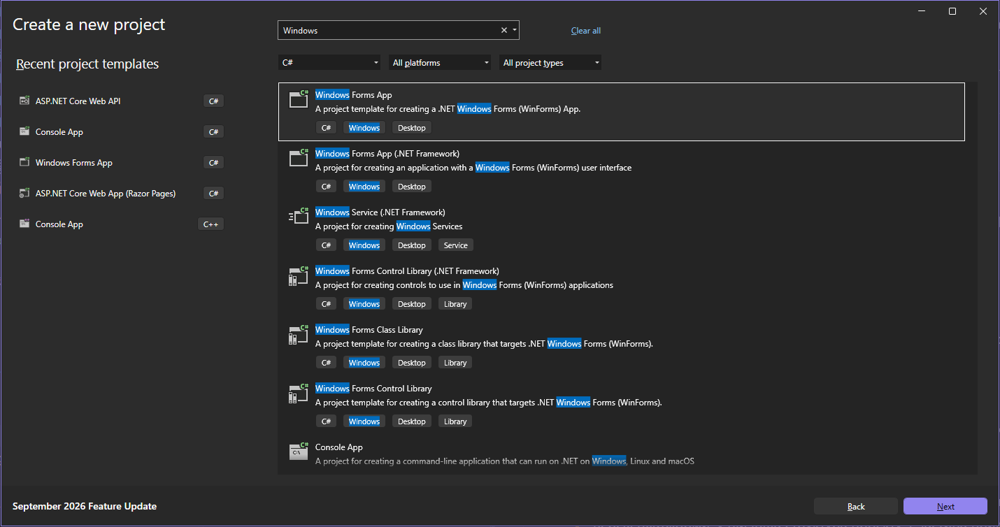
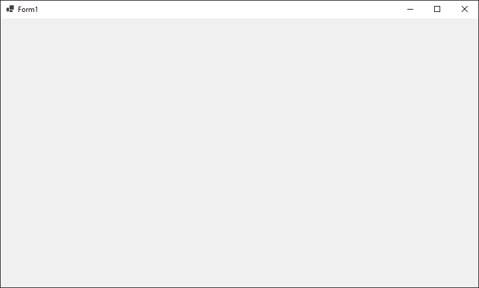
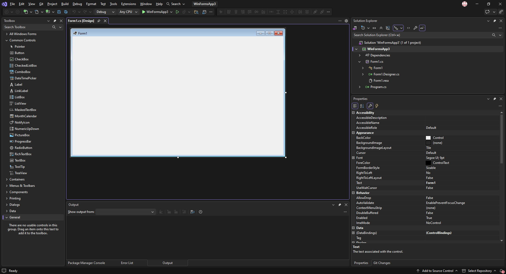
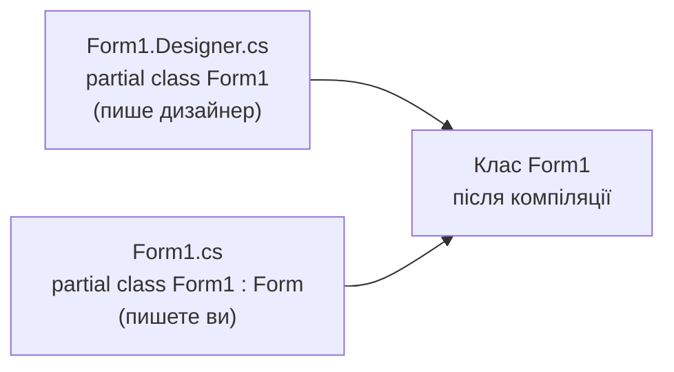
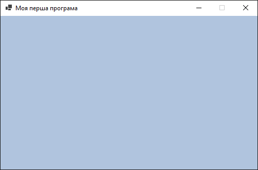
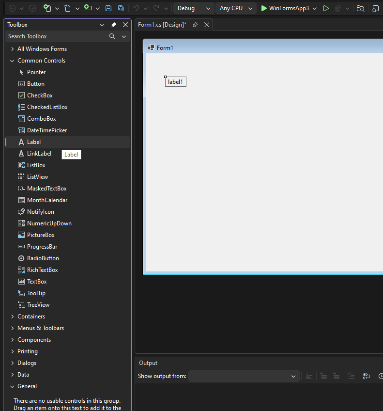
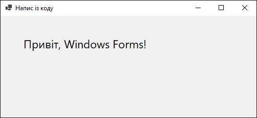
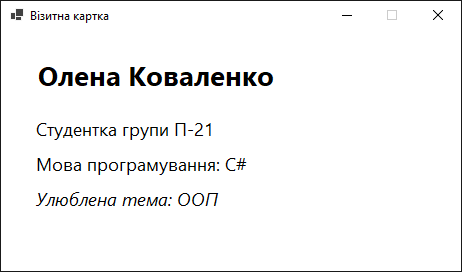

# 7. Вступ до Windows Forms

![block-badge] ![lang-badge]

## Зміст
1. [Консольні та віконні програми](#консольні-та-віконні-програми)
2. [Що таке Windows Forms](#що-таке-windows-forms)
3. [Створення проєкту](#створення-проєкту)
4. [Середовище Visual Studio](#середовище-visual-studio)
5. [Структура проєкту](#структура-проєкту)
6. [Часткові класи](#часткові-класи)
7. [Властивості форми](#властивості-форми)
8. [Елементи керування](#елементи-керування)
9. [Повний приклад](#повний-приклад)
10. [Порівняння дизайнера та коду](#порівняння-дизайнера-та-коду)
11. [Windows Forms серед інших технологій](#windows-forms-серед-інших-технологій)
12. [Підсумок](#підсумок)
13. [Запитання для самоперевірки](#запитання-для-самоперевірки)
14. [Довідкові матеріали](#довідкові-матеріали)

---

## Консольні та віконні програми

Досі всі наші програми були **консольними**: чорне вікно, текст рядок за рядком, `Console.WriteLine` і `Console.ReadLine`. Програма сама вирішує, що відбувається далі, а користувач лише відповідає на її запитання.

Але програми, якими ви користуєтеся щодня — браузер, месенджер, Провідник Windows, — виглядають інакше: у них є вікна, кнопки, поля для введення, меню. Це програми з **графічним інтерфейсом**.

> **Графічний інтерфейс користувача** (Graphical User Interface, GUI) — спосіб взаємодії з програмою через _візуальні елементи_: вікна, кнопки, поля, списки, — якими користувач керує мишею та клавіатурою.

| Критерій | Консольна програма | Віконна програма |
| :---- | :---- | :---- |
| **Вигляд** | Текст у консолі | Вікна з кнопками, полями, зображеннями |
| **Хто керує порядком дій** | Програма: «введіть число…» | Користувач: обирає, що й коли робити |
| **Як працює** | Виконує команди зверху вниз і завершується | Чекає на дії користувача й реагує на них |
| **Введення даних** | `Console.ReadLine()` | Поля, списки, перемикачі |
| **Виведення** | `Console.WriteLine()` | Написи, таблиці, малюнки у вікні |

Найголовніша різниця — у третьому рядку. Віконна програма після запуску **не виконує план від початку до кінця**, а чекає: поки користувач натисне кнопку, введе текст, закриє вікно. На кожну таку дію програма реагує. Як саме це влаштовано, розберемо в наступному уроці, а зараз навчимося створювати саме вікно.

---

## Що таке Windows Forms

> **Windows Forms** (WinForms) — бібліотека .NET для створення _віконних програм для Windows_. Вікно в ній називається **формою** (form), а кнопки, написи й поля на формі — **елементами керування** (controls).

Windows Forms — одна з найстаріших і найпростіших технологій для віконних програм на C#. Її головна перевага для навчання: вікно можна «намалювати» мишею в **дизайнері** Visual Studio, а потім оживити кодом.

**Навіщо вивчати Windows Forms:**

- швидкий результат: перша віконна програма — за кілька хвилин
- знання ООП стають у пригоді одразу: форма — це клас, кнопка — об'єкт, її текст — властивість
- принципи (події, елементи керування, компонування) однакові для більшості технологій інтерфейсу
- на Windows Forms досі працює чимало реальних програм — особливо внутрішніх корпоративних систем

---

## Створення проєкту

1. Запустіть Visual Studio і оберіть **Create a new project**
2. У пошуку шаблонів введіть `Windows Forms` і оберіть **Windows Forms App** з позначкою **C#** → **Next**



3. Введіть назву проєкту (наприклад, `FirstWinForms`) і місце збереження → **Next**
4. У полі **Framework** оберіть **.NET 8.0 (Long Term Support)** → **Create**

> [!WARNING]
> **Часта помилка:** обрати шаблон **Windows Forms App (.NET Framework)**. Це стара версія платформи: у ній інша структура проєкту, і частина прикладів з уроків працювати не буде. Потрібен шаблон **без** «(.NET Framework)» у назві.

Після створення проєкту натисніть `F5` (або зелену кнопку ▶ на панелі інструментів). З'явиться ваша перша віконна програма — поки що порожня:



Вікно вже багато чого вміє: його можна перетягувати, змінювати розмір, згортати, розгортати на весь екран і закривати. І все це — без жодного рядка вашого коду.

---

## Середовище Visual Studio

Під час роботи з Windows Forms у Visual Studio ви постійно користуватиметеся чотирма вікнами:

| Вікно | Як відкрити | Для чого |
| :---- | :---- | :---- |
| **Дизайнер форми** (Designer) | Двічі клацніть `Form1.cs` у Solution Explorer | Візуальне редагування форми: розміщення й розмір елементів |
| **Toolbox** (панель елементів) | `Ctrl + Alt + X` або **View → Toolbox** | Набір елементів керування, які можна перетягнути на форму |
| **Properties** (властивості) | `F4` або **View → Properties Window** | Властивості виділеного елемента чи самої форми |
| **Solution Explorer** | `Ctrl + Alt + L` | Файли проєкту |



> [!TIP]
> **Порада:** перемикатися між дизайнером і кодом форми зручно клавішами: `F7` — відкрити код (`Form1.cs`), `Shift + F7` — повернутися в дизайнер.

---

## Структура проєкту

Новий проєкт Windows Forms складається з кількох файлів:

```
FirstWinForms/
├── FirstWinForms.csproj
├── Program.cs
├── Form1.cs
├── Form1.Designer.cs
└── Form1.resx
```

На диску файли лежать поруч, а в Solution Explorer файли `Form1.Designer.cs` і `Form1.resx` «приховані» усередині `Form1.cs` — розгорніть його стрілкою, щоб побачити (на скриншоті вище — праворуч угорі).

| Файл | Що містить | Хто його пише |
| :---- | :---- | :---- |
| **`Program.cs`** | Точку входу `Main`, яка запускає головну форму | Шаблон; змінюється рідко |
| **`Form1.cs`** | Ваш код форми | **Ви** |
| **`Form1.Designer.cs`** | Код, який описує все, що ви «намалювали» в дизайнері | **Дизайнер** — автоматично |
| **`Form1.resx`** | Ресурси форми (зображення, іконки) | Дизайнер |

### Program.cs — запуск програми

```C#
namespace FirstWinForms;

static class Program
{
    /// <summary>
    ///  The main entry point for the application.
    /// </summary>
    [STAThread]
    static void Main()
    {
        // To customize application configuration such as set high DPI settings or default font,
        // see https://aka.ms/applicationconfiguration.
        ApplicationConfiguration.Initialize();
        Application.Run(new Form1());
    }
}
```

Знайомий метод `Main` — точка входу. Найважливіший рядок — останній: `new Form1()` **створює об'єкт** форми (урок 1), а `Application.Run(...)` показує його й тримає програму запущеною, доки цю форму не закриють. Рядки над ним лише налаштовують програму — змінювати їх не потрібно.

> [!NOTE]
> **Зверніть увагу:** залежно від версії Visual Studio код шаблону може трохи відрізнятися — наприклад, простір імен записаний з фігурними дужками `namespace FirstWinForms { ... }`, а перед `static class` стоїть `internal`. Як ви пам'ятаєте з уроку 3, це той самий код, лише інша форма запису.

### Form1.cs — ваш код форми

```C#
namespace FirstWinForms;

public partial class Form1 : Form
{
    public Form1()
    {
        InitializeComponent();
    }
}
```

Тут використано майже все, що ви вивчили в модулі ООП:

| Фрагмент | Що це | Урок |
| :---- | :---- | :---- |
| **`class Form1`** | Клас нашого вікна | 1 |
| **`: Form`** | Наслідування: `Form1` **є** формою й отримує від класу `Form` усі вміння вікна — заголовок, рамку, кнопки «згорнути» і «закрити» | 5 |
| **`public Form1()`** | Конструктор — виконується, коли в `Program.cs` пишемо `new Form1()` | 1 |
| **`InitializeComponent()`** | Виклик методу, який створює все, що намальовано в дизайнері (він лежить у `Form1.Designer.cs`) | — |
| **`partial`** | Клас розділено на кілька файлів — про це наступний розділ | — |

> [!IMPORTANT]
> **Ключова ідея:** форма — це звичайний клас C#, що наслідує `Form`. Кожне вікно програми — об'єкт цього класу.

---

## Часткові класи

Подивіться на `Form1.Designer.cs` — там теж оголошено клас `Form1`:

```C#
namespace FirstWinForms;

partial class Form1
{
    /// <summary>
    ///  Required designer variable.
    /// </summary>
    private System.ComponentModel.IContainer components = null;

    // ... метод Dispose ...

    #region Windows Form Designer generated code

    /// <summary>
    ///  Required method for Designer support - do not modify
    ///  the contents of this method with the code editor.
    /// </summary>
    private void InitializeComponent()
    {
        components = new System.ComponentModel.Container();
        AutoScaleMode = AutoScaleMode.Font;
        ClientSize = new Size(800, 450);
        Text = "Form1";
    }

    #endregion
}
```

Два файли з однаковим класом — і жодної помилки? Так, бо обидва оголошення позначені словом `partial`.

> **Частковий клас** (partial class) — клас, _оголошення якого розділене на кілька частин_, зазвичай у різних файлах. Під час компіляції всі частини об'єднуються в один клас.

Навіщо це у Windows Forms: код форми поділено між **двома авторами**. Дизайнер Visual Studio пише в `Form1.Designer.cs` усе, що ви робите мишею, а ви пишете свій код у `Form1.cs`. Так дизайнер не зачіпає ваш код, а ви — його.



На схемі: дві частини класу з різних файлів компілятор збирає в один клас `Form1`.

> [!WARNING]
> **Часта помилка:** редагувати `Form1.Designer.cs` вручну. Дизайнер перезаписує цей файл щоразу, коли ви щось змінюєте на формі, — ваші правки зникнуть, а помилка в ньому може «зламати» дизайнер так, що форма перестане відкриватися. Недарма в коментарі шаблону написано: _do not modify the contents of this method with the code editor_ — «не змінюйте вміст цього методу в редакторі коду». Свій код пишіть лише у `Form1.cs`.

---

## Властивості форми

Вигляд і поведінку форми визначають її **властивості** (урок 2). Більшість із них форма успадкувала від класу `Form`.

| Властивість | Що визначає | Приклад значення |
| :---- | :---- | :---- |
| **`Text`** | Заголовок вікна | `"Моя перша програма"` |
| **`ClientSize`** | Розмір внутрішньої частини вікна (без рамки й заголовка) | `new Size(500, 300)` |
| **`BackColor`** | Колір фону | `Color.LightSteelBlue` |
| **`StartPosition`** | Де з'являється вікно під час запуску | `FormStartPosition.CenterScreen` |
| **`FormBorderStyle`** | Вигляд рамки; чи можна змінювати розмір вікна | `FormBorderStyle.FixedSingle` |
| **`MaximizeBox`** | Чи активна кнопка «розгорнути» | `false` |
| **`Name`** | Ім'я об'єкта в коді | `"Form1"` |

### Через вікно Properties

Виділіть форму в дизайнері, натисніть `F4` і змініть, наприклад, властивість `Text`. Заголовок у дизайнері зміниться одразу, а у файлі `Form1.Designer.cs` дизайнер допише відповідний рядок, наприклад `Text = "Моя перша програма";`.

### Через код

Ті самі властивості можна задати в коді — у конструкторі форми, **після** виклику `InitializeComponent()`:

```C#
public partial class Form1 : Form
{
    public Form1()
    {
        InitializeComponent();

        Text = "Моя перша програма";
        ClientSize = new Size(500, 300);
        BackColor = Color.LightSteelBlue;
        StartPosition = FormStartPosition.CenterScreen;
        FormBorderStyle = FormBorderStyle.FixedSingle;
        MaximizeBox = false;
    }
}
```

Результат роботи:



Кнопка «розгорнути» неактивна (`MaximizeBox = false`), а розмір вікна мишею змінити не вийде (`FixedSingle`).

Значення, задані в коді, дизайнер не показує: у ньому форма й далі матиме заголовок `Form1` і сірий фон. Результат видно лише після запуску (`F5`).

**Нові записи в цьому коді:**

- `new Size(500, 300)` — розмір: ширина й висота в пікселях
- `Color.LightSteelBlue` — готовий колір; у типі `Color` їх понад сотню (`Color.White`, `Color.Orange`…)
- `FormStartPosition.CenterScreen` і `FormBorderStyle.FixedSingle` — значення **переліків** (enum): набір іменованих варіантів, з яких зазвичай обирають один. Visual Studio після крапки покаже всі доступні варіанти

> [!WARNING]
> **Часта помилка:** задати властивості **до** `InitializeComponent()`. Цей метод задає все, що налаштовано в дизайнері (щонайменше `Text` і `ClientSize`), — і перезапише ваші значення. А елементів з дизайнера (наприклад, `label1`) до його виклику ще взагалі не існує. Тому свій код у конструкторі пишіть після нього.

---

## Елементи керування

Порожня форма — лише рамка. Корисною її роблять **елементи керування** (controls): написи, кнопки, поля для введення.

> **Елемент керування** (control) — об'єкт класу на кшталт `Label` чи `Button`, який _розміщується на формі_ й відповідає за окрему частину інтерфейсу.

Найпростіший елемент — **`Label`** (напис): він просто показує текст.

### Через дизайнер

Відкрийте Toolbox (`Ctrl + Alt + X`), знайдіть **Label** і перетягніть його на форму. Потім у вікні Properties змініть його `Text`, наприклад на `Привіт!`.



> [!WARNING]
> **Часта помилка:** двічі клацнути форму чи напис у дизайнері. Visual Studio створить у `Form1.cs` порожній метод-обробник події (про події — в наступному уроці). Якщо видалити його вручну, проєкт перестане збиратися, а дизайнер не відкриється. Щоб скасувати випадкове подвійне клацання, одразу натисніть `Ctrl + Z` у дизайнері.

А тепер — найцікавіше: подивіться, що дизайнер дописав у `Form1.Designer.cs` (фрагмент):

```C#
private void InitializeComponent()
{
    label1 = new Label();
    // ...
    label1.AutoSize = true;
    label1.Location = new Point(40, 40);
    label1.Name = "label1";
    // ... розмір і порядок переходу (Size, TabIndex)
    label1.Text = "Привіт!";
    // ...
    Controls.Add(label1);
    // ...
}

private Label label1;
```

Це звичайний код на C#, який ви вже вмієте читати:

- `private Label label1;` — **поле** форми типу `Label` (уроки 1 і 4)
- `label1 = new Label();` — **створення об'єкта** напису (урок 1)
- `label1.Text = "Привіт!";` — **властивість** напису (урок 2)
- `Controls.Add(label1);` — напис **додається на форму**: форма _має_ список своїх елементів `Controls` — зв'язок «має» з уроку 4

### Через код

Отже, елемент керування можна створити й без дизайнера — тим самим кодом, у конструкторі форми. Щоб написи не накладалися, спершу видаліть `label1`, доданий у дизайнері (виділити → `Delete`), або створіть новий проєкт:

```C#
public partial class Form1 : Form
{
    public Form1()
    {
        InitializeComponent();

        Text = "Напис із коду";
        ClientSize = new Size(500, 200);

        Label greeting = new Label();
        greeting.Text = "Привіт, Windows Forms!";
        greeting.Font = new Font("Segoe UI", 16);
        greeting.AutoSize = true;
        greeting.Location = new Point(40, 40);
        Controls.Add(greeting);
    }
}
```

Результат роботи:



| Властивість `Label` | Що визначає |
| :---- | :---- |
| **`Text`** | Текст напису |
| **`Location`** | Положення лівого верхнього кута: `new Point(x, y)` — відступ від лівого й верхнього країв форми |
| **`Font`** | Шрифт і розмір у пунктах: `new Font("Segoe UI", 16)` |
| **`AutoSize`** | Якщо `true` — напис сам підлаштовує розмір під текст. Для напису, створеного в коді, за замовчуванням `false` — тоді довгий текст обрізається |
| **`ForeColor`** | Колір тексту |

> [!NOTE]
> **Зверніть увагу:** система координат форми починається в **лівому верхньому куті** її внутрішньої частини: `x` зростає праворуч, `y` — **донизу**, а не вгору, як у шкільній математиці.

> [!TIP]
> **Порада:** дизайнер дає елементам імена на кшталт `label1`, `label2`, `button1`. У великій формі в них легко заплутатися, тому відразу перейменовуйте елементи у властивості `Name`, додаючи короткий префікс типу: `lblTitle`, `lblResult`, `btnCalculate`. Детальніше про іменування — в наступному уроці.

---

## Повний приклад

Зберемо все разом: віконна програма «Візитна картка» з налаштованим вікном і кількома написами (у чистому проєкті або після видалення попередніх написів). Щоб не повторювати однаковий код для кожного напису, винесемо його в окремий метод форми `AddLabel`.

#### `Form1.cs` — код форми

```C#
namespace FirstWinForms;

public partial class Form1 : Form
{
    public Form1()
    {
        InitializeComponent();

        // Налаштування вікна
        Text = "Візитна картка";
        ClientSize = new Size(460, 240);
        BackColor = Color.White;
        StartPosition = FormStartPosition.CenterScreen;
        FormBorderStyle = FormBorderStyle.FixedSingle;
        MaximizeBox = false;

        // Написи
        AddLabel("Олена Коваленко", 30, 25, 20, FontStyle.Bold);
        AddLabel("Студентка групи П-21", 30, 85, 13, FontStyle.Regular);
        AddLabel("Мова програмування: C#", 30, 120, 13, FontStyle.Regular);
        AddLabel("Улюблена тема: ООП", 30, 155, 13, FontStyle.Italic);
    }

    // Створює напис і додає його на форму
    private void AddLabel(string text, int x, int y, float fontSize, FontStyle style)
    {
        Label label = new Label();
        label.Text = text;
        label.AutoSize = true;
        label.Location = new Point(x, y);
        label.Font = new Font("Segoe UI", fontSize, style);
        Controls.Add(label);
    }
}
```

Результат роботи:



Зверніть увагу на `FontStyle.Bold`, `FontStyle.Regular`, `FontStyle.Italic` — це знову перелік: жирне, звичайне й курсивне накреслення шрифту.

> [!IMPORTANT]
> **Ключова ідея:** усе у вікні — об'єкти. Форма — об'єкт класу `Form1`, кожен напис — об'єкт класу `Label`, а налаштування — значення їхніх властивостей. Дизайнер лише пише цей код замість вас.

---

## Порівняння дизайнера та коду

| Критерій | Дизайнер | Код |
| :---- | :---- | :---- |
| **Як працює** | Перетягування мишею, вікно Properties | Створення об'єктів і задавання властивостей у конструкторі |
| **Де зберігається результат** | `Form1.Designer.cs` (генерується автоматично) | `Form1.cs` (пишете ви) |
| **Швидкість** | Швидко: кілька клацань | Повільніше: кожну властивість треба написати |
| **Наочність** | Одразу видно, як виглядатиме форма | Результат видно лише після запуску — дизайнер значень із коду не показує |
| **Гнучкість** | Лише те, що відомо заздалегідь | Елементи можна створювати під час роботи програми — скільки й коли потрібно |

**Головна різниця** — дизайнер зручний для того, що відомо заздалегідь (розташування кнопок і полів), а код — для того, що з'являється під час роботи програми. У реальних проєктах їх поєднують: вікно «малюють» у дизайнері, а поведінку описують у коді.

---

## Windows Forms серед інших технологій

Windows Forms — не єдиний спосіб створити віконну програму на C#:

| Технологія | Особливості |
| :---- | :---- |
| **[Windows Forms](https://learn.microsoft.com/dotnet/desktop/winforms/overview/)** | Найпростіша для старту; програми лише для Windows; дизайнер з перетягуванням елементів |
| **[WPF](https://learn.microsoft.com/dotnet/desktop/wpf/overview/)** | Інтерфейс описується мовою розмітки XAML; гнучкий дизайн і анімації; лише Windows |
| **[WinUI 3](https://learn.microsoft.com/windows/apps/winui/winui3/)** | Сучасний вигляд Windows 11; XAML; лише Windows 10/11 |
| **[.NET MAUI](https://learn.microsoft.com/dotnet/maui/what-is-maui)** | Один код для Windows, macOS, Android та iOS |
| **[Avalonia UI](https://avaloniaui.net/)** | Кросплатформна технологія з XAML, схожа на WPF |

Те, що ви вивчите на Windows Forms, — форми, елементи керування, властивості, події, — є в кожній із цих технологій. Змінюється лише спосіб опису інтерфейсу.

---

## Підсумок

- **віконна програма** не виконується зверху вниз, а чекає на дії користувача й реагує на них
- **Windows Forms** — бібліотека .NET для віконних програм; вікно в ній — **форма**, а написи, кнопки й поля — **елементи керування**
- форма — це клас, що **наслідує** `Form`; `Application.Run(new Form1())` створює й показує головне вікно
- клас форми — **частковий** (`partial`): код дизайнера лежить у `Form1.Designer.cs` (його не редагують вручну), а ваш код — у `Form1.cs`
- властивості форми й елементів задають у вікні Properties або в коді конструктора **після** `InitializeComponent()`
- **елемент керування** — об'єкт (`new Label()`), який з'являється на формі після `Controls.Add(...)`; дизайнер генерує саме такий код

---

## Запитання для самоперевірки

1. Чим віконна програма відрізняється від консольної?
2. Що таке форма та елемент керування у Windows Forms?
3. Який шаблон проєкту потрібно обрати у Visual Studio і яку версію .NET?
4. Що робить рядок `Application.Run(new Form1());`?
5. Що означає запис `class Form1 : Form`? Що форма отримує від класу `Form`?
6. Навіщо клас форми розділено на два файли? Чому не можна вручну редагувати `Form1.Designer.cs`?
7. Чому властивості форми в конструкторі задають після `InitializeComponent()`?
8. Які кроки потрібні, щоб додати `Label` на форму з коду?

---

## Довідкові матеріали

- [Windows Forms](https://uk.wikipedia.org/wiki/Windows_Forms) — `uk.wikipedia.org`
- [Графічний інтерфейс користувача](https://uk.wikipedia.org/wiki/%D0%93%D1%80%D0%B0%D1%84%D1%96%D1%87%D0%BD%D0%B8%D0%B9_%D1%96%D0%BD%D1%82%D0%B5%D1%80%D1%84%D0%B5%D0%B9%D1%81_%D0%BA%D0%BE%D1%80%D0%B8%D1%81%D1%82%D1%83%D0%B2%D0%B0%D1%87%D0%B0) — `uk.wikipedia.org`
- [What is Windows Forms](https://learn.microsoft.com/dotnet/desktop/winforms/overview/) — `learn.microsoft.com`
- [Create a Windows Forms app with C#](https://learn.microsoft.com/visualstudio/ide/create-csharp-winform-visual-studio) — `learn.microsoft.com`
- [Partial Classes and Members](https://learn.microsoft.com/dotnet/csharp/programming-guide/classes-and-structs/partial-classes-and-methods) — `learn.microsoft.com`
- [Form Class](https://learn.microsoft.com/dotnet/api/system.windows.forms.form) — `learn.microsoft.com`
- [Label Class](https://learn.microsoft.com/dotnet/api/system.windows.forms.label) — `learn.microsoft.com`

---
[block-badge]:https://img.shields.io/badge/Windows%20Forms-purple?style=flat
[lang-badge]:https://img.shields.io/badge/C%23-blue?style=flat&logo=dotnet
