# 8. Події та базові елементи керування

![block-badge] ![lang-badge]

## Зміст
1. [Як віконна програма реагує на дії](#як-віконна-програма-реагує-на-дії)
2. [Перша кнопка](#перша-кнопка)
3. [Іменування елементів](#іменування-елементів)
4. [Підписка на подію](#підписка-на-подію)
5. [sender та EventArgs](#sender-та-eventargs)
6. [Базові елементи керування](#базові-елементи-керування)
7. [Подія TextChanged](#подія-textchanged)
8. [MessageBox](#messagebox)
9. [Повний приклад](#повний-приклад)
10. [Порівняння способів підписки](#порівняння-способів-підписки)
11. [Події в інших технологіях](#події-в-інших-технологіях)
12. [Підсумок](#підсумок)
13. [Запитання для самоперевірки](#запитання-для-самоперевірки)
14. [Довідкові матеріали](#довідкові-матеріали)

---

## Як віконна програма реагує на дії

В уроці 7 ми з'ясували: віконна програма не виконується зверху вниз, а **чекає** на дії користувача. Але як саме вона дізнається, що користувач натиснув кнопку?

> **Подія** (event) — повідомлення від об'єкта про те, що _з ним щось сталося_: кнопку натиснули, текст у полі змінився, вікно закривається.
>
> **Обробник події** (event handler) — метод, який _автоматично викликається_, коли подія стається.

Аналогія — дверний дзвінок. Дзвінок нічого не знає про те, хто відчинятиме двері. Він лише «повідомляє»: «на мене натиснули!». А господар заздалегідь вирішив: «коли дзвонять — іду відчиняти». Дзвінок — це **подія**, а дії господаря — **обробник**.

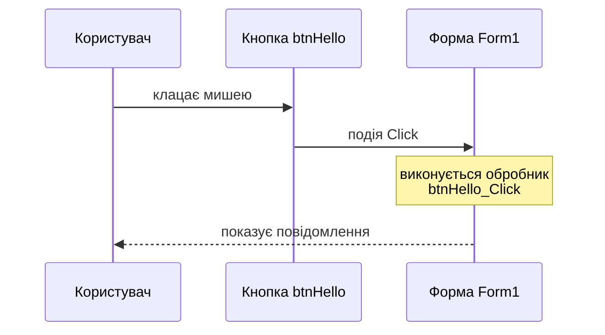

На схемі: користувач клацає кнопку, кнопка генерує подію `Click`, а форма у відповідь виконує метод-обробник.

Програмування, за якого програма складається з реакцій на події, називають **подійно-орієнтованим** (event-driven). Так влаштовані майже всі програми з інтерфейсом — від Блокнота до браузера.

---

## Перша кнопка

Додамо на форму кнопку й навчимо її реагувати на натискання.

1. Перетягніть з Toolbox на форму елемент **Button**
2. У вікні Properties змініть його `Name` на `btnHello`, а `Text` — на `Натисни мене`. Заголовок форми (`Text` форми) — `Перша кнопка`
3. **Двічі клацніть** кнопку в дизайнері

Visual Studio відкриє `Form1.cs` і створить у ньому порожній метод-обробник. Залишається дописати один рядок:

```C#
public partial class Form1 : Form
{
    public Form1()
    {
        InitializeComponent();
    }

    private void btnHello_Click(object sender, EventArgs e)
    {
        MessageBox.Show("Привіт! Ви натиснули кнопку.");
    }
}
```

Запустіть програму (`F5`):

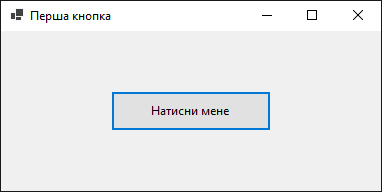

Натисніть кнопку — з'явиться маленьке вікно з повідомленням:

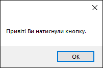

`MessageBox.Show(...)` — статичний метод (урок 3), що показує окреме вікно з повідомленням. Детально його можливості розберемо в розділі [MessageBox](#messagebox).

### Що зробила Visual Studio

Подвійне клацання зробило **дві** речі:

- у `Form1.cs` — створило метод `btnHello_Click`
- у `Form1.Designer.cs` — додало рядок, що «пов'язує» подію з методом:

```C#
btnHello.Click += btnHello_Click;
```

Цей рядок читається так: «коли в `btnHello` станеться подія `Click`, виклич метод `btnHello_Click`». Саме цей зв'язок називають **підпискою на подію**.

> [!IMPORTANT]
> **Ключова ідея:** обробник події — звичайний метод форми. Ви його не викликаєте самі: його викликає кнопка, коли користувач її натискає.

---

## Іменування елементів

Дизайнер називає елементи `button1`, `button2`, `textBox1`. У формі з десятком елементів такі імена нічого не кажуть: що робить `button7_Click`? Тому кожному елементу дають осмислене ім'я з коротким **префіксом** типу:

| Елемент | Префікс | Приклад імені | Типовий обробник |
| :---- | :---- | :---- | :---- |
| **`Button`** | `btn` | `btnCalculate` | `btnCalculate_Click` |
| **`Label`** | `lbl` | `lblResult` | — |
| **`TextBox`** | `txt` | `txtName` | `txtName_TextChanged` |

Ім'я змінюють у властивості `Name` у вікні Properties.

> [!WARNING]
> **Часта помилка:** спершу двічі клацнути кнопку, а **потім** перейменувати її. Метод-обробник залишиться зі старою назвою `button1_Click` — програма працюватиме, але код стане заплутаним. Правильний порядок: **спершу `Name`, потім подвійне клацання**. Якщо ж помилка вже сталася, перейменуйте метод у редакторі коду клавішею `F2` (Rename): Visual Studio оновить і рядок підписки в `Form1.Designer.cs`.

---

## Підписка на подію

Подвійне клацання підписує на **основну** подію елемента: для кнопки це `Click`, для текстового поля — `TextChanged`, для форми — `Load`. Але подій у кожного елемента десятки. Є три способи підписатися на будь-яку з них.

### Вікно Properties → Events

У вікні Properties натисніть кнопку з блискавкою ⚡ — з'явиться список усіх подій виділеного елемента. Двічі клацніть порожнє поле навпроти потрібної події — і Visual Studio створить обробник.

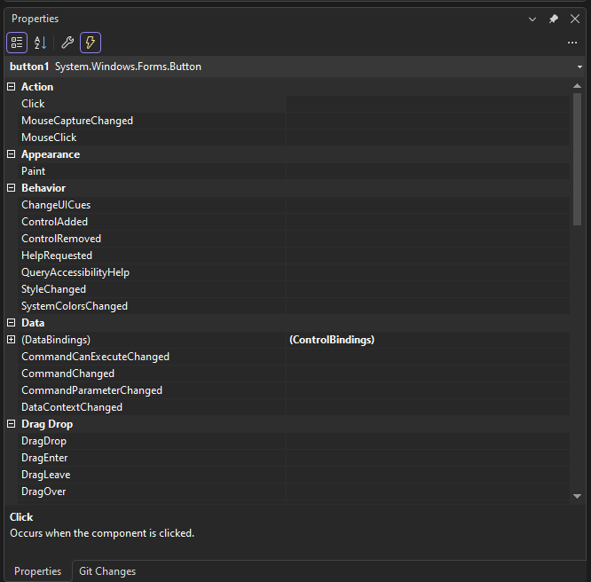

### У коді: оператор +=

Підписку можна написати й самостійно — у конструкторі форми, після `InitializeComponent()`. Для експерименту візьміть новий проєкт або кнопку **без** обробника з дизайнера — інакше кнопка матиме два обробники, і повідомлення з'явиться двічі:

```C#
public Form1()
{
    InitializeComponent();
    btnHello.Click += BtnHello_Click;
}

private void BtnHello_Click(object? sender, EventArgs e)
{
    MessageBox.Show("Привіт! Ви натиснули кнопку.");
}
```

Оператор `+=` **додає** обробник до події, а `-=` — прибирає його.

Дизайнер називає обробники за шаблоном `елемент_Подія` (`btnHello_Click`). Методи, які ви пишете й підписуєте самі, зазвичай називають за загальним правилом C# — з великої літери (`BtnHello_Click`).

> [!NOTE]
> **Зверніть увагу:** у підписці з власного коду параметр записано як `object? sender` — зі знаком `?`. Він означає, що `sender` теоретично може бути `null` (урок 4). Без `?` компілятор покаже попередження `CS8622`. В обробниках, які створює дизайнер, Visual Studio пише `object sender` без `?` — і попередження немає, бо підписка лежить у `Form1.Designer.cs`, який компілятор вважає згенерованим кодом.

---

## sender та EventArgs

Кожен обробник отримує два параметри:

| Параметр | Що в ньому | Навіщо |
| :---- | :---- | :---- |
| **`sender`** | Об'єкт, **який** викликав подію | Коли один обробник обслуговує кілька елементів — дізнатися, хто саме |
| **`e`** (`EventArgs`) | **Подробиці** події | Деякі події передають додаткові дані — наприклад, можливість скасувати закриття вікна (у [повному прикладі](#повний-приклад)) |

Ось як `sender` дозволяє обійтися **одним** обробником для трьох кнопок. На формі `Кольори` — три кнопки без обробників з дизайнера:

| `Name` | `Text` | `BackColor` |
| :---- | :---- | :---- |
| **`btnRed`** | `Червоний` | `LightCoral` |
| **`btnGreen`** | `Зелений` | `LightGreen` |
| **`btnBlue`** | `Синій` | `LightSkyBlue` |


```C#
public partial class Form1 : Form
{
    public Form1()
    {
        InitializeComponent();

        btnRed.Click += ColorButton_Click;
        btnGreen.Click += ColorButton_Click;
        btnBlue.Click += ColorButton_Click;
    }

    // Один обробник для трьох кнопок
    private void ColorButton_Click(object? sender, EventArgs e)
    {
        if (sender is Button button) // яка саме кнопка викликала подію?
        {
            BackColor = button.BackColor;
            Text = $"Обрано: {button.Text}";
        }
    }
}
```

Результат роботи після натискання кнопки «Зелений»:

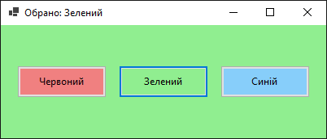

Параметр `sender` має тип `object` — найзагальніший тип (урок 5). Перевірка `sender is Button button` (урок 6) перевіряє, що це кнопка, і дає змінну `button` типу `Button`, у якої можна взяти колір і текст. Без `sender` довелося б писати три майже однакові обробники.

---

## Базові елементи керування

| Елемент | Для чого | Головні властивості | Головна подія |
| :---- | :---- | :---- | :---- |
| **[Label](https://learn.microsoft.com/dotnet/api/system.windows.forms.label)** | Показати текст | `Text`, `Font`, `ForeColor`, `AutoSize` | — |
| **[Button](https://learn.microsoft.com/dotnet/api/system.windows.forms.button)** | Виконати дію | `Text`, `Enabled` | `Click` |
| **[TextBox](https://learn.microsoft.com/dotnet/api/system.windows.forms.textbox)** | Ввести текст | `Text`, `PlaceholderText`, `Multiline`, `ReadOnly`, `MaxLength` | `TextChanged` |

Корисні властивості:

- **`Enabled`** — якщо `false`, елемент сірий і не реагує на дії. Так вимикають кнопку, поки не заповнено потрібне поле
- **`PlaceholderText`** у `TextBox` — сіра підказка в порожньому полі, наприклад «Введіть ім'я»
- **`Multiline`** у `TextBox` — дозволяє вводити кілька рядків
- **`ReadOnly`** у `TextBox` — текст можна виділити й скопіювати, але не змінити
- **`UseSystemPasswordChar`** у `TextBox` — приховує введені символи, як у полі пароля
- **`AcceptButton`** у форми — кнопка, яка «натискається» клавішею `Enter`; **`CancelButton`** — клавішею `Esc`

Текст поля читають і змінюють через властивість `Text`, а очищають методом `Clear()`:

```C#
string name = txtName.Text; // прочитати
txtName.Text = "Олена";    // записати
txtName.Clear();           // очистити
```

---

## Подія TextChanged

Подія `TextChanged` у `TextBox` спрацьовує **після кожної зміни тексту** — з кожним введеним чи видаленим символом. І не лише коли текст вводить користувач: так само вона спрацьовує, коли текст змінює код (`txtName.Text = ...`, `txtName.Clear()`). Це дозволяє реагувати на введення «наживо».

На формі `Лічильник символів` — поле `txtName`, напис `lblCount` з текстом `Символів: 0` і кнопка `btnOk` з текстом `Готово`, у якої в дизайнері встановлено `Enabled = false`:

```C#
private void txtName_TextChanged(object sender, EventArgs e)
{
    lblCount.Text = $"Символів: {txtName.Text.Length}";
    btnOk.Enabled = txtName.Text.Length > 0;
}
```

Результат роботи після введення імені «Олена»:

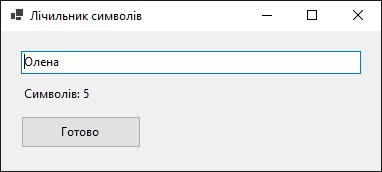

Поки поле порожнє, кнопка «Готово» вимкнена; щойно з'являється хоча б один символ — вмикається.

> [!TIP]
> **Порада:** вимкнена кнопка — ввічливіший спосіб сказати користувачеві «спершу заповніть поле», ніж повідомлення про помилку після натискання.

---

## MessageBox

> **`MessageBox`** — клас для показу _стандартного вікна повідомлення_: з текстом, заголовком, іконкою й кнопками. Його метод `Show(...)` показує вікно й **чекає**, доки користувач його не закриє.

Поки вікно повідомлення відкрите, основна форма недоступна — це **модальне** вікно. Код після `MessageBox.Show(...)` виконається лише після того, як користувач натисне одну з кнопок.

### Текст і заголовок

```C#
MessageBox.Show("Файл збережено.");               // лише текст
MessageBox.Show("Файл збережено.", "Збереження"); // текст і заголовок
```

Результат роботи другого рядка:

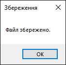

### Кнопки: MessageBoxButtons

Третій параметр задає набір кнопок — значення переліку `MessageBoxButtons`. Основні з них:

| Значення | Кнопки |
| :---- | :---- |
| **`OK`** | OK (за замовчуванням) |
| **`OKCancel`** | OK, Скасувати |
| **`YesNo`** | Так, Ні |
| **`YesNoCancel`** | Так, Ні, Скасувати |
| **`RetryCancel`** | Повторити, Скасувати |
| **`AbortRetryIgnore`** | Перервати, Повторити, Пропустити |
| **`CancelTryContinue`** | Скасувати, Повторити, Продовжити — сучасна заміна `AbortRetryIgnore` |

### Іконки: MessageBoxIcon

Четвертий параметр задає іконку — значення переліку `MessageBoxIcon`. Іконка одразу підказує, якого роду повідомлення:

| Значення | Коли використовувати | Приклад |
| :---- | :---- | :---- |
| **`Information`** | Повідомити, що все гаразд | «Файл збережено.» |
| **`Warning`** | Попередити про можливу проблему | «Файл уже існує.» |
| **`Error`** | Повідомити про помилку | «Файл не знайдено.» |
| **`Question`** | Поставити запитання | «Зберегти зміни?» |
| **`None`** | Без іконки (за замовчуванням) | — |

```C#
MessageBox.Show("Файл збережено.", "Інформація", MessageBoxButtons.OK, MessageBoxIcon.Information);
MessageBox.Show("Файл уже існує.", "Попередження", MessageBoxButtons.OK, MessageBoxIcon.Warning);
MessageBox.Show("Файл не знайдено.", "Помилка", MessageBoxButtons.OK, MessageBoxIcon.Error);
MessageBox.Show("Зберегти зміни?", "Запитання", MessageBoxButtons.YesNoCancel, MessageBoxIcon.Question);
```

Результат роботи:

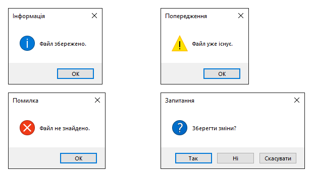

> [!NOTE]
> **Зверніть увагу:** підписи кнопок («Так», «Ні», «Скасувати») Windows бере з мови системи. В англомовній Windows ті самі вікна матимуть кнопки «Yes», «No», «Cancel». У коді від цього нічого не залежить.

### Що натиснув користувач: DialogResult

`MessageBox.Show(...)` **повертає** значення переліку `DialogResult` — яку кнопку натиснув користувач. Саме так програма отримує відповідь на запитання:

```C#
DialogResult result = MessageBox.Show("Видалити запис?", "Підтвердження",
    MessageBoxButtons.YesNo, MessageBoxIcon.Question);

if (result == DialogResult.Yes)
{
    // видаляємо запис
}
```

Результат роботи:

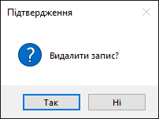

| Кнопка | Значення `DialogResult` |
| :---- | :---- |
| **OK** | `DialogResult.OK` |
| **Скасувати** | `DialogResult.Cancel` |
| **Так** | `DialogResult.Yes` |
| **Ні** | `DialogResult.No` |
| **Повторити** | `DialogResult.Retry` (у `CancelTryContinue` — `DialogResult.TryAgain`) |
| **Перервати** / **Пропустити** / **Продовжити** | `DialogResult.Abort` / `DialogResult.Ignore` / `DialogResult.Continue` |

Хрестик (і клавіша `Esc`) працює як кнопка «Скасувати»: якщо вона є, `Show` поверне `DialogResult.Cancel`. Якщо такої кнопки немає, у вікні лише з `OK` хрестик поверне `DialogResult.OK`, а у вікнах `YesNo` та `AbortRetryIgnore` хрестик неактивний — користувач мусить обрати одну з кнопок.

### Кнопка за замовчуванням

Кнопка, виділена за замовчуванням, «натискається» клавішею `Enter`. Зазвичай це перша кнопка. Для небезпечних дій (вихід без збереження, видалення) за замовчуванням краще зробити безпечну відповідь — п'ятим параметром `MessageBoxDefaultButton`:

```C#
MessageBox.Show("Ви справді хочете вийти?", "Вихід",
    MessageBoxButtons.YesNo, MessageBoxIcon.Warning, MessageBoxDefaultButton.Button2);
```

Тепер за замовчуванням виділена друга кнопка — «Ні», і випадкове натискання `Enter` нічого не зіпсує.

### Основні варіанти виклику

| Виклик | Що показує |
| :---- | :---- |
| **`Show(текст)`** | Текст і кнопку OK |
| **`Show(текст, заголовок)`** | + заголовок вікна |
| **`Show(текст, заголовок, кнопки)`** | + набір кнопок |
| **`Show(текст, заголовок, кнопки, іконка)`** | + іконку |
| **`Show(текст, заголовок, кнопки, іконка, кнопкаЗаЗамовчуванням)`** | + кнопку, виділену за замовчуванням |

Є й інші, рідковживані варіанти — наприклад, із вказанням вікна-власника.

> [!WARNING]
> **Часта помилка:** показувати `MessageBox` з будь-якого приводу: «Кнопку натиснуто», «Текст змінено», «Дані завантажено». Модальне вікно перериває роботу — щоб продовжити, користувач мусить його закрити. `MessageBox` доречний для важливих повідомлень, помилок і запитань, які потребують рішення. Звичайні статуси краще показувати в `Label` на формі.

---

## Повний приклад

Програма «Привітання»: користувач вводить ім'я, бачить попередній перегляд привітання, може привітатися й очистити поле, а під час виходу програма питає підтвердження.

### Елементи форми

Розмістіть у дизайнері такі елементи й задайте їм властивості:

| Елемент | `Name` | `Text` | Інші властивості |
| :---- | :---- | :---- | :---- |
| **Label** | `lblPrompt` | `Введіть ваше ім'я:` | — |
| **TextBox** | `txtName` | — | — |
| **Label** | `lblPreview` | `Привіт, ...!` | `Font`: Segoe UI, 12, Bold |
| **Button** | `btnGreet` | `Привітати` | `Enabled`: `False` |
| **Button** | `btnClear` | `Очистити` | — |
| **Form** | `Form1` | `Привітання` | `AcceptButton`: `btnGreet`, `FormBorderStyle`: `FixedSingle`, `MaximizeBox`: `False` |

Обробники: `TextChanged` для `txtName`, `Click` для обох кнопок (подвійне клацання) і **`FormClosing`** для форми (через вкладку ⚡ у Properties).

#### `Form1.cs` — код форми

```C#
public partial class Form1 : Form
{
    public Form1()
    {
        InitializeComponent();
    }

    // Під час введення: оновлюємо підказку й вмикаємо або вимикаємо кнопку
    private void txtName_TextChanged(object sender, EventArgs e)
    {
        string name = txtName.Text.Trim();
        btnGreet.Enabled = name.Length > 0;

        if (name.Length > 0)
        {
            lblPreview.Text = $"Привіт, {name}!";
        }
        else
        {
            lblPreview.Text = "Привіт, ...!";
        }
    }

    private void btnGreet_Click(object sender, EventArgs e)
    {
        string name = txtName.Text.Trim();
        MessageBox.Show($"Радий знайомству, {name}!", "Привітання",
            MessageBoxButtons.OK, MessageBoxIcon.Information);
    }

    private void btnClear_Click(object sender, EventArgs e)
    {
        DialogResult result = MessageBox.Show("Очистити введене ім'я?", "Підтвердження",
            MessageBoxButtons.YesNo, MessageBoxIcon.Question);

        if (result == DialogResult.Yes)
        {
            txtName.Clear();
            txtName.Focus();
        }
    }

    // Перед закриттям вікна питаємо підтвердження
    private void Form1_FormClosing(object sender, FormClosingEventArgs e)
    {
        DialogResult result = MessageBox.Show("Ви справді хочете вийти?", "Вихід",
            MessageBoxButtons.YesNo, MessageBoxIcon.Warning, MessageBoxDefaultButton.Button2);

        if (result == DialogResult.No)
        {
            e.Cancel = true; // скасувати закриття вікна
        }
    }
}
```

Результат роботи після введення імені:

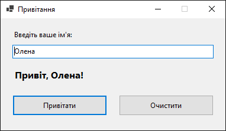

Після натискання «Привітати» (або клавіші `Enter` — це `AcceptButton`):

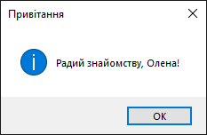

Під час закриття вікна хрестиком:

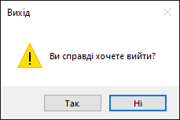

**Що тут нового:**

- `Trim()` прибирає пробіли на початку й у кінці рядка — ім'я з самих пробілів не вважається введеним
- `txtName.Focus()` повертає курсор у поле — можна одразу вводити нове ім'я
- після `txtName.Clear()` спрацьовує `TextChanged` — тому підказка й кнопка «Привітати» оновлюються самі, без окремого коду
- подія **`FormClosing`** спрацьовує, коли вікно ось-ось закриється. Її параметр `e` має тип `FormClosingEventArgs` з властивістю `Cancel`: якщо записати в неї `true`, вікно **не закриється**. Це той випадок, коли `EventArgs` передає обробнику не просто «щось сталося», а можливість вплинути на подію

> [!IMPORTANT]
> **Ключова ідея:** уся логіка програми — це набір обробників: кожен відповідає на одну дію користувача. Програма не «йде» від початку до кінця, а реагує на події в тому порядку, в якому їх створює користувач.

---

## Порівняння способів підписки

| Спосіб | Як | Коли зручно |
| :---- | :---- | :---- |
| **Подвійне клацання в дизайнері** | Двічі клацнути елемент | Основна подія елемента (`Click`, `TextChanged`, `Load`) |
| **Вкладка ⚡ у Properties** | Двічі клацнути поле навпроти події | Будь-яка інша подія (`FormClosing`, `MouseEnter`…) |
| **Оператор `+=` у коді** | `btn.Click += Метод;` у конструкторі | Один обробник для кількох елементів; елементи, створені в коді |

**Головна різниця** — перші два способи записують підписку в `Form1.Designer.cs` автоматично, а третій дає повний контроль: можна підписати будь-які елементи на будь-який метод, зокрема ті, що створюються під час роботи програми.

---

## Події в інших технологіях

Події — не винахід Windows Forms. Ця ідея лежить в основі майже будь-якого інтерфейсу:

| Технологія | Як це виглядає |
| :---- | :---- |
| **Windows Forms** | `btnSave.Click += btnSave_Click;` |
| **[Веб-сторінки (JavaScript)](https://developer.mozilla.org/en-US/docs/Web/API/EventTarget/addEventListener)** | `button.addEventListener("click", save);` |
| **[Події в C# загалом](https://learn.microsoft.com/dotnet/csharp/programming-guide/events/)** | Будь-який клас може оголосити власну подію, на яку підписуються інші об'єкти |

Принцип скрізь однаковий: елемент повідомляє «зі мною щось сталося», а ваш код заздалегідь підписаний на це повідомлення. Як оголошувати власні події у своїх класах, розберемо в окремій темі.

---

## Підсумок

- **подія** — повідомлення об'єкта про те, що з ним щось сталося; **обробник** — метод, який автоматично викликається у відповідь
- підписка на подію записується оператором `+=`; її створює дизайнер (подвійне клацання, вкладка ⚡) або програміст у конструкторі форми
- обробник отримує `sender` — хто викликав подію — та `e` — подробиці події (наприклад, `e.Cancel` у `FormClosing`)
- елементи називають з префіксом типу (`btnGreet`, `txtName`, `lblPreview`) **до** створення обробників; `TextChanged` дозволяє реагувати на введення «наживо» — наприклад, вмикати кнопку (`Enabled`) лише коли поле заповнене
- `MessageBox.Show(...)` показує модальне вікно з текстом, заголовком, кнопками й іконкою та повертає `DialogResult` — відповідь користувача

---

## Запитання для самоперевірки

1. Що таке подія та обробник події? Наведіть приклад з життя.
2. Що робить Visual Studio, коли ви двічі клацаєте кнопку в дизайнері?
3. Що означає рядок `btnSave.Click += btnSave_Click;`?
4. Чому елементи перейменовують до того, як створити обробник?
5. Що передається в параметрі `sender`? Коли він корисний?
6. Коли спрацьовує подія `TextChanged`?
7. Чим відрізняються виклики `MessageBox.Show("Текст")` і `MessageBox.Show("Текст", "Заголовок", MessageBoxButtons.YesNo, MessageBoxIcon.Question)`?
8. Як дізнатися, яку кнопку натиснув користувач у вікні `MessageBox`?
9. Як заборонити закриття вікна, якщо користувач відповів «Ні»?

---

## Довідкові матеріали

- [Подійно-орієнтоване програмування](https://uk.wikipedia.org/wiki/%D0%9F%D0%BE%D0%B4%D1%96%D0%B9%D0%BD%D0%BE-%D0%BE%D1%80%D1%96%D1%94%D0%BD%D1%82%D0%BE%D0%B2%D0%B0%D0%BD%D0%B5_%D0%BF%D1%80%D0%BE%D0%B3%D1%80%D0%B0%D0%BC%D1%83%D0%B2%D0%B0%D0%BD%D0%BD%D1%8F) — `uk.wikipedia.org`
- [Events Overview](https://learn.microsoft.com/dotnet/desktop/winforms/forms/events) — `learn.microsoft.com`
- [MessageBox Class](https://learn.microsoft.com/dotnet/api/system.windows.forms.messagebox) — `learn.microsoft.com`
- [MessageBoxButtons Enum](https://learn.microsoft.com/dotnet/api/system.windows.forms.messageboxbuttons) — `learn.microsoft.com`
- [MessageBoxIcon Enum](https://learn.microsoft.com/dotnet/api/system.windows.forms.messageboxicon) — `learn.microsoft.com`
- [DialogResult Enum](https://learn.microsoft.com/dotnet/api/system.windows.forms.dialogresult) — `learn.microsoft.com`
- [Form.FormClosing Event](https://learn.microsoft.com/dotnet/api/system.windows.forms.form.formclosing) — `learn.microsoft.com`

---
[block-badge]:https://img.shields.io/badge/Windows%20Forms-purple?style=flat
[lang-badge]:https://img.shields.io/badge/C%23-blue?style=flat&logo=dotnet
