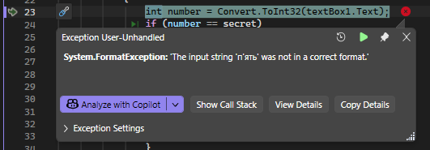
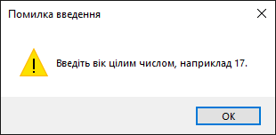
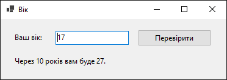
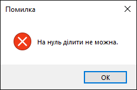
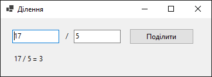
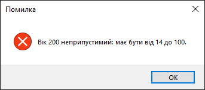
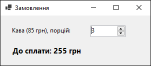
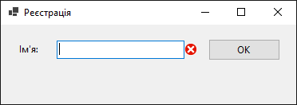
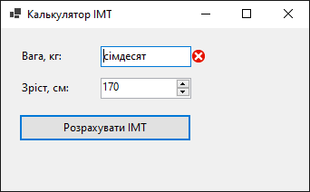
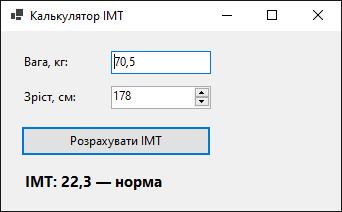

# 9. Введення та перевірка даних

![block-badge] ![lang-badge]

## Зміст
1. [Що буде, якщо ввести не число](#що-буде-якщо-ввести-не-число)
2. [Перетворення тексту на число](#перетворення-тексту-на-число)
3. [TryParse: безпечне перетворення](#tryparse-безпечне-перетворення)
4. [Перевірка значень](#перевірка-значень)
5. [Винятки та try-catch](#винятки-та-try-catch)
6. [Власні винятки: throw](#власні-винятки-throw)
7. [NumericUpDown](#numericupdown)
8. [ErrorProvider](#errorprovider)
9. [Повний приклад](#повний-приклад)
10. [Порівняння способів перевірки введення](#порівняння-способів-перевірки-введення)
11. [Перевірка даних у реальних програмах](#перевірка-даних-у-реальних-програмах)
12. [Підсумок](#підсумок)
13. [Запитання для самоперевірки](#запитання-для-самоперевірки)
14. [Довідкові матеріали](#довідкові-матеріали)

---

## Що буде, якщо ввести не число

Найпростіший спосіб перетворити текст із `TextBox` на число — `Convert.ToDouble`:

```C#
double radius = Convert.ToDouble(txtRadius.Text);
```

Поки користувач вводить `5`, усе працює. А якщо він введе `п'ять`, залишить поле порожнім або напише `2.5` з крапкою? Замість результату програма покаже **аварійне вікно**. Під час запуску з Visual Studio (`F5`) середовище покаже, де саме сталася помилка:



На скриншоті — `Convert.ToInt32` (перетворення на ціле число), але з `Convert.ToDouble` помилка та сама: `FormatException`.

А якщо запустити програму без Visual Studio, користувач побачить вікно з незрозумілим технічним повідомленням (зазвичай англійською) і кнопками «Details», «Continue» та «Quit». «Continue» дозволяє працювати далі, але дія, на якій сталася помилка, так і не виконається; «Quit» закриває програму.

Користувачі помиляються постійно: випадково натискають не ту клавішу, вставляють зайві пробіли, пишуть слова замість чисел. Добра програма **не довіряє введенню**: вона перевіряє дані й пояснює, що не так, замість того щоб зупинятися.

---

## Перетворення тексту на число

Властивість `Text` у `TextBox` — це завжди **рядок**, навіть якщо в полі цифри. Щоб рахувати, текст треба перетворити на число:

| Спосіб | Приклад | Якщо текст не є числом |
| :---- | :---- | :---- |
| **`int.Parse`** | `int age = int.Parse(txtAge.Text);` | Виняток — програма зупиниться |
| **`double.Parse`** | `double price = double.Parse(txtPrice.Text);` | Виняток |
| **`Convert.ToDouble`** | `double r = Convert.ToDouble(txtRadius.Text);` | Виняток |
| **`int.TryParse`** | `int.TryParse(txtAge.Text, out int age)` | Повертає `false` — програма працює далі |

Ось які помилки — **винятки** (exceptions), докладно про них нижче — виникають на практиці:

| Що перетворюємо | Результат |
| :---- | :---- |
| **`int.Parse("abc")`** | `FormatException: The input string 'abc' was not in a correct format.` |
| **`int.Parse("")`** | `FormatException: The input string '' was not in a correct format.` |
| **`int.Parse("99999999999")`** | `OverflowException: Value was either too large or too small for an Int32.` — число завелике для `int` |
| **`double.Parse("2.5")`** | `FormatException` — на українській Windows дробову частину відокремлює **кома** |
| **`double.Parse("2,5")`** | `2,5` — усе гаразд |

> [!NOTE]
> **Зверніть увагу:** роздільник дробової частини залежить від регіональних налаштувань Windows. На комп'ютерах з українськими налаштуваннями це кома (`2,5`), з англійськими — крапка (`2.5`). Підступніше інше: на англійських налаштуваннях текст `2,5` **без жодної помилки** перетвориться на `25` — кому буде сприйнято як роздільник тисяч. Підказуйте користувачеві формат прямо біля поля: наприклад, `PlaceholderText = "напр. 70,5"`.

---

## TryParse: безпечне перетворення

> **`TryParse`** — метод, який _пробує_ перетворити текст на число й **повертає `true` або `false`** — вдалося чи ні. Саме число він повертає через параметр з ключовим словом `out`.

```C#
if (int.TryParse(txtAge.Text, out int age))
{
    // успіх: у змінній age — число
}
else
{
    // текст не є цілим числом — показуємо підказку
}
```

| Частина | Що означає |
| :---- | :---- |
| **`int.TryParse(...)`** | Повертає `bool`: `true` — текст є цілим числом |
| **`txtAge.Text`** | Текст, який перетворюємо |
| **`out int age`** | Нова змінна, у яку метод **запише** результат. Слово `out` означає «вихідний параметр»: метод повертає через нього ще одне значення |

Якщо перетворення не вдалося, `TryParse` повертає `false`, а в `age` записує `0`. Змінна, оголошена через `out int age` в умові `if`, доступна й після `if` — до кінця методу. Для дробових чисел є `double.TryParse(..., out double x)`, для `decimal` — `decimal.TryParse`.

### Приклад: перевірка віку

На формі «Вік» — поле `txtAge`, кнопка `btnCheck` і напис `lblResult`:

```C#
public partial class Form1 : Form
{
    public Form1()
    {
        InitializeComponent();
    }

    private void btnCheck_Click(object sender, EventArgs e)
    {
        if (!int.TryParse(txtAge.Text, out int age))
        {
            MessageBox.Show("Введіть вік цілим числом, наприклад 17.", "Помилка введення",
                MessageBoxButtons.OK, MessageBoxIcon.Warning);
            txtAge.Focus();
            return;
        }

        if (age < 0 || age > 120)
        {
            MessageBox.Show("Вік має бути від 0 до 120.", "Помилка введення",
                MessageBoxButtons.OK, MessageBoxIcon.Warning);
            txtAge.Focus();
            return;
        }

        lblResult.Text = $"Через 10 років вам буде {age + 10}.";
    }
}
```

Результат роботи, якщо ввести `abc`:



Результат роботи, якщо ввести `17`:



Зверніть увагу на `!` перед `int.TryParse` — це «НЕ»: «якщо **не** вдалося перетворити…». А `return` одразу завершує обробник — решта коду з некоректними даними не виконується.

---

## Перевірка значень

Навіть коректне число може бути **неприйнятним**: вік `-5`, ціна `0`, кількість `1000000`. Тому після перетворення перевіряють ще й діапазон — як у прикладі вище:

```C#
if (age < 0 || age > 120)
```

Типові перевірки введення:

| Що перевіряємо | Як |
| :---- | :---- |
| **Поле не порожнє** | `string.IsNullOrWhiteSpace(txtName.Text)` |
| **Текст є числом** | `int.TryParse(...)`, `double.TryParse(...)` |
| **Число в межах** | `if (x < мінімум \|\| x > максимум)` |
| **Довжина тексту** | `txtPassword.Text.Length < 6` |

**Що робити, коли дані некоректні:**

- повідомити, **що саме** не так і **як правильно**: «Вік має бути від 0 до 120», а не «Помилка»
- повернути курсор у поле з помилкою — `txtAge.Focus()`
- зупинити обробник — `return`, щоб некоректні дані не потрапили в розрахунок

> [!TIP]
> **Порада:** перевіряйте дані **на початку** обробника й одразу виходьте з `return`, якщо щось не так. Тоді основна логіка внизу працює вже з гарантовано правильними даними.

---

## Винятки та try-catch

`TryParse` захищає лише від помилок перетворення. Але є й інші ситуації, коли код не може виконатися: ділення на нуль, звернення до файлу, якого немає, некоректне значення у властивості класу.

> **Виняток** (exception) — об'єкт, який описує _помилку під час виконання програми_. Коли виникає виняток, звичайне виконання коду переривається. Якщо виняток ніхто не **перехопив**, програма аварійно зупиняється.

В уроці 2 ми обіцяли розглянути винятки — ось вони. Перехоплюють винятки конструкцією **`try-catch`**:

```C#
try
{
    // код, у якому може виникнути виняток
}
catch (FormatException)
{
    // що робити, якщо виник саме такий виняток
}
```

Якщо в блоці `try` виник виняток, виконання **одразу переходить** до блоку `catch` відповідного типу (решта коду в `try` пропускається), а програма продовжує працювати. Якщо жоден `catch` не підходить, виняток «летить» далі — так, наче `try-catch` не було.

### Приклад: ділення

На формі «Ділення» — поля `txtA`, `txtB`, кнопка `btnDivide` і напис `lblResult`:

```C#
public partial class Form1 : Form
{
    public Form1()
    {
        InitializeComponent();
    }

    private void btnDivide_Click(object sender, EventArgs e)
    {
        try
        {
            int a = int.Parse(txtA.Text);
            int b = int.Parse(txtB.Text);
            int result = a / b;
            lblResult.Text = $"{a} / {b} = {result}";
        }
        catch (FormatException)
        {
            MessageBox.Show("Введіть цілі числа.", "Помилка",
                MessageBoxButtons.OK, MessageBoxIcon.Error);
        }
        catch (OverflowException)
        {
            MessageBox.Show("Число завелике.", "Помилка",
                MessageBoxButtons.OK, MessageBoxIcon.Error);
        }
        catch (DivideByZeroException)
        {
            MessageBox.Show("На нуль ділити не можна.", "Помилка",
                MessageBoxButtons.OK, MessageBoxIcon.Error);
        }
    }
}
```

Результат роботи для `10 / 0`:



Результат роботи для `17 / 5`:



Ділення двох `int` дає ціле число — тому `17 / 5 = 3`. А от ділення `double` на нуль винятку не дає: результатом буде нескінченність (`∞`).

Кожен тип винятку — це клас. Ось поширені:

| Виняток | Коли виникає |
| :---- | :---- |
| **`FormatException`** | Текст не вдається перетворити на число |
| **`OverflowException`** | Число не вміщується в тип (`int.Parse("99999999999")`) |
| **`DivideByZeroException`** | Ціле ділення на нуль |
| **`ArgumentException`** | Методу чи властивості передали неприпустиме значення |
| **`Exception`** | Базовий клас **усіх** винятків (урок 5: наслідування) |

### Перехоплення будь-якого винятку

Оскільки всі винятки наслідують клас `Exception`, блок `catch (Exception ex)` перехопить будь-який із них. Змінна `ex` — сам об'єкт винятку, а в його властивості `Message` — опис помилки (знадобиться розробникові):

```C#
catch (Exception ex)
{
    MessageBox.Show("Сталася непередбачена помилка.", "Помилка",
        MessageBoxButtons.OK, MessageBoxIcon.Error);
}
```

Якщо блоків `catch` кілька, вони перевіряються **зверху вниз**, тому `catch (Exception)` ставлять **останнім**. Загальний блок перед конкретними компілятор не пропустить: конкретні вже ніколи б не спрацювали.

> [!WARNING]
> **Часта помилка:** обгорнути весь код у `try { ... } catch (Exception) { }` з порожнім `catch`. Помилка «зникне», але програма мовчки працюватиме неправильно, і знайти причину стане майже неможливо. Перехоплюйте конкретні винятки, які очікуєте, і завжди повідомляйте про них. Повідомлення з `ex.Message` — англійською й технічне, тому користувачеві краще показувати власний текст.

> [!TIP]
> **Порада:** для перевірки введення користувача зручніше `TryParse` — помилкове введення там звична ситуація, а не виняткова. `try-catch` залишайте для справді виняткових випадків: ділення на нуль, помилки роботи з файлами, неприпустимі значення в класах.

---

## Власні винятки: throw

Винятки можна не лише перехоплювати, а й **генерувати** самостійно — оператором `throw`. Пригадайте клас `Student` з уроку 2: у разі неприпустимого віку властивість лише виводила повідомлення в консоль. Тепер ми знаємо правильний спосіб — згенерувати виняток. Візьмемо спрощений `Student` — лише з властивістю `Age`:

#### `Student.cs` — модель

```C#
internal class Student
{
    private int age;

    public int Age
    {
        get { return age; }
        set
        {
            if (value < 14 || value > 100)
            {
                throw new ArgumentException($"Вік {value} неприпустимий: має бути від 14 до 100.");
            }
            age = value;
        }
    }
}
```

`throw new ArgumentException("...")` створює об'єкт винятку з описом і «кидає» його — виконання `set` припиняється, і значення **не** записується. Якщо в конструкторі присвоювати вік через властивість (урок 2), той самий виняток не дасть навіть створити об'єкт з неприпустимим віком. Клас нічого не знає про форми та `MessageBox` — він лише повідомляє: «так не можна».

А форма перехоплює виняток і сама вирішує, як показати помилку:

#### `Form1.cs` — код форми

```C#
public partial class Form1 : Form
{
    private Student student = new Student();

    public Form1()
    {
        InitializeComponent();
    }

    private void btnSave_Click(object sender, EventArgs e)
    {
        if (!int.TryParse(txtAge.Text, out int age))
        {
            MessageBox.Show("Введіть вік цілим числом.", "Помилка введення",
                MessageBoxButtons.OK, MessageBoxIcon.Warning);
            return;
        }

        try
        {
            student.Age = age; // set може згенерувати виняток
            MessageBox.Show("Вік збережено.", "Готово",
                MessageBoxButtons.OK, MessageBoxIcon.Information);
        }
        catch (ArgumentException ex)
        {
            MessageBox.Show(ex.Message, "Помилка",
                MessageBoxButtons.OK, MessageBoxIcon.Error);
        }
    }
}
```

Результат роботи, якщо ввести `200`:



Тут `ex.Message` — наш власний український текст, тож його можна показувати користувачеві.

> [!IMPORTANT]
> **Ключова ідея:** клас перевіряє свої дані й **генерує** виняток (`throw`), а форма його **перехоплює** (`try-catch`) і показує користувачеві. Кожен робить свою справу: клас стежить за правилами, форма спілкується з людиною.

---

## NumericUpDown

Найпростіший спосіб уникнути помилок введення числа — не давати вводити текст узагалі.

> **`NumericUpDown`** — поле для введення **числа** зі стрілками «вгору/вниз». Літери ввести в нього не можна, а число поза межами автоматично замінюється на `Minimum` або `Maximum`.

| Властивість | Що визначає |
| :---- | :---- |
| **`Value`** | Поточне значення (тип `decimal` — дробовий тип з точними десятковими обчисленнями, зазвичай для грошей) |
| **`Minimum`**, **`Maximum`** | Межі допустимих значень |
| **`Increment`** | Крок зміни стрілками (за замовчуванням `1`) |
| **`DecimalPlaces`** | Скільки знаків після коми **показувати** (`0` — без дробової частини) |

Головна подія — **`ValueChanged`**: спрацьовує після зміни значення стрілками, а якщо число вводять з клавіатури — після `Enter` або переходу до іншого поля.

На формі «Замовлення» — `nudQuantity` з `Minimum = 1`, `Maximum = 10` і жирний напис `lblTotal`:

```C#
private void nudQuantity_ValueChanged(object sender, EventArgs e)
{
    decimal total = nudQuantity.Value * 85;
    lblTotal.Text = $"До сплати: {total} грн";
}
```

Результат роботи після вибору трьох порцій:



Жодного `TryParse`: `Value` — це вже число, причому гарантовано в межах від 1 до 10. Число `85` у виразі автоматично стає `decimal`.

> [!NOTE]
> **Зверніть увагу:** `Value` має тип `decimal`. Якщо потрібен `int` чи `double`, значення приводять явно: `(int)nudQuantity.Value` або `(double)nudHeight.Value`. `DecimalPlaces = 0` лише ховає дробову частину: якщо користувач введе `2,5`, `Value` буде `2,5`. Для цілої кількості використовуйте `(int)nudQuantity.Value`.

---

## ErrorProvider

`MessageBox` перериває роботу, а якщо полів багато, користувач може забути, що саме було не так. Зручніше показати помилку **прямо біля поля**.

> **`ErrorProvider`** — компонент, що показує біля елемента керування _червоний значок помилки_; якщо навести на значок курсор, з'явиться підказка з текстом помилки.

Перетягніть **ErrorProvider** з Toolbox на форму — він з'явиться не на самій формі, а на панелі під нею (component tray) як невидимий компонент. Далі в коді:

| Метод | Що робить |
| :---- | :---- |
| **`errorProvider1.SetError(txtName, "Введіть ім'я")`** | Показує значок біля `txtName` з цим текстом |
| **`errorProvider1.SetError(txtName, "")`** | Прибирає значок (порожній рядок — «помилки немає») |

На формі «Реєстрація» — поле `txtName`, кнопка `btnOk`, напис `lblResult` і `errorProvider1`:

```C#
private void btnOk_Click(object sender, EventArgs e)
{
    if (string.IsNullOrWhiteSpace(txtName.Text))
    {
        errorProvider1.SetError(txtName, "Введіть ім'я");
        return;
    }

    errorProvider1.SetError(txtName, ""); // прибрати позначку помилки
    lblResult.Text = $"Вітаємо, {txtName.Text.Trim()}!";
}
```

Результат роботи, якщо натиснути «OK» з порожнім полем:



> [!TIP]
> **Порада:** за замовчуванням (`BlinkIfDifferentError`) значок кілька разів блимає, коли з'являється нова помилка. Якщо це відволікає, встановіть у властивостях компонента `BlinkStyle = NeverBlink`.

---

## Повний приклад

«Калькулятор ІМТ» (індекс маси тіла = вага в кілограмах, поділена на квадрат зросту в метрах). Вагу вводимо в `TextBox` і перевіряємо через `TryParse` та `ErrorProvider`, зріст — через `NumericUpDown`, який перевіряти не потрібно.

### Елементи форми

| Елемент | `Name` | Властивості |
| :---- | :---- | :---- |
| **TextBox** | `txtWeight` | — |
| **NumericUpDown** | `nudHeight` | `Minimum`: 100, `Maximum`: 250, `Value`: 170 |
| **Button** | `btnCalculate` | `Text`: `Розрахувати ІМТ` |
| **Label** | `lblResult` | `Font`: Segoe UI, 11, Bold |
| **ErrorProvider** | `errorProvider1` | `BlinkStyle`: `NeverBlink` |
| **Form** | `Form1` | `Text`: `Калькулятор ІМТ`, `AcceptButton`: `btnCalculate` |

Плюс написи `Вага, кг:` і `Зріст, см:` біля полів.

#### `Form1.cs` — код форми

```C#
public partial class Form1 : Form
{
    public Form1()
    {
        InitializeComponent();
    }

    private void btnCalculate_Click(object sender, EventArgs e)
    {
        // 1. Перевірка ваги: число та розумний діапазон
        if (!double.TryParse(txtWeight.Text, out double weight) || weight < 20 || weight > 300)
        {
            errorProvider1.SetError(txtWeight, "Введіть вагу від 20 до 300 кг, наприклад 70,5");
            lblResult.Text = "";
            return;
        }
        errorProvider1.SetError(txtWeight, "");

        // 2. Зріст із NumericUpDown — перевіряти не потрібно
        double height = (double)nudHeight.Value / 100; // см → м

        // 3. Розрахунок
        double bmi = Math.Round(weight / (height * height), 1);
        lblResult.Text = $"ІМТ: {bmi} — {GetCategory(bmi)}";
    }

    private string GetCategory(double bmi)
    {
        if (bmi < 18.5)
        {
            return "недостатня вага";
        }
        if (bmi < 25)
        {
            return "норма";
        }
        if (bmi < 30)
        {
            return "надмірна вага";
        }
        return "ожиріння";
    }
}
```

Результат роботи, якщо замість числа ввести слово:



Результат роботи для ваги `70,5` кг і зросту `178` см:



**Що тут варто помітити:**

- одна умова перевіряє одразу три речі: `!double.TryParse(...) || weight < 20 || weight > 300` — «не число, **або** замало, **або** забагато». `||` обчислюється зліва направо й зупиняється на першому `true`: якщо текст не число, межі вже не перевіряються
- у коді дробові числа пишуть **з крапкою** (`18.5`) — незалежно від того, кому чи крапку вводить користувач
- розрахунок категорії винесено в окремий метод `GetCategory` — обробник кнопки залишається коротким

> [!IMPORTANT]
> **Ключова ідея:** перевіряйте текстове введення на початку обробника, а для чисел у межах обирайте `NumericUpDown` — тоді перевіряти доводиться менше.

---

## Порівняння способів перевірки введення

| Спосіб | Коли використовувати | Що отримує користувач |
| :---- | :---- | :---- |
| **`TryParse` + `if`** | Перевірка введеного тексту — основний спосіб | Зрозуміле повідомлення про помилку |
| **`try-catch`** | Виняткові ситуації: ділення на нуль, помилки з файлами, винятки з класів | Повідомлення замість аварійної зупинки |
| **`NumericUpDown`** | Числа в заданих межах | Взагалі не може ввести неправильно |
| **`ErrorProvider`** | Не перевірка, а спосіб **показати** помилку — біля конкретного поля | Значок біля поля з помилкою |

**Головна різниця** — `NumericUpDown` не дає помилитися, `TryParse` перевіряє введення заздалегідь, а `try-catch` **реагує** на помилки, яких не вдалося уникнути. Найкраще поєднувати: обирати елементи, що не дають помилитися, перевіряти решту введення й залишати `try-catch` для непередбачуваного.

---

## Перевірка даних у реальних програмах

Перевірка введення — обов'язкова частина будь-якої програми, з якою працюють люди:

| Де | Як виглядає |
| :---- | :---- |
| **Реєстрація на сайті** | Червона рамка й підказка під полем: «Пароль має містити щонайменше 8 символів» |
| **Інтернет-банк** | Поле суми не приймає літер, а суму, більшу за залишок, підсвічує червоним |
| **Форми на веб-сторінках** | Браузер сам перевіряє обов'язкові поля, формат пошти й діапазон чисел ([Client-side form validation](https://developer.mozilla.org/en-US/docs/Learn_web_development/Extensions/Forms/Form_validation)) |

Принцип скрізь однаковий: перевіряти дані якомога раніше, пояснювати помилку біля місця, де вона сталася, і не дозволяти некоректним даним потрапити далі — у розрахунки чи базу даних.

---

## Підсумок

- `Parse` і `Convert.To...` генерують **виняток**, якщо текст не є числом; **`TryParse`** повертає `false` і записує результат у змінну з `out`
- після перетворення перевіряють ще й **діапазон**, а при помилці показують зрозуміле повідомлення, повертають курсор у поле (`Focus()`) і виходять з обробника (`return`)
- **виняток** — об'єкт, що описує помилку; `try-catch` перехоплює його, а `throw` генерує власний (наприклад, у `set` властивості)
- **`NumericUpDown`** не дає ввести нечислове значення чи вийти за межі `Minimum`/`Maximum`; значення — у `Value` типу `decimal`
- **`ErrorProvider`** показує значок помилки біля поля: `SetError(поле, "текст")` — показати, `SetError(поле, "")` — прибрати

---

## Запитання для самоперевірки

1. Що станеться, якщо передати в `int.Parse` текст `abc`? А в `int.TryParse`?
2. Що означає слово `out` у виклику `int.TryParse(txtAge.Text, out int age)`?
3. Чому `double.Parse("2.5")` може не спрацювати на українській Windows?
4. Що потрібно зробити в обробнику, коли введені дані некоректні?
5. Що таке виняток? Що станеться з програмою, якщо виняток ніхто не перехопив?
6. Як працює конструкція `try-catch`? Навіщо кілька блоків `catch`?
7. Навіщо генерувати виняток (`throw`) у властивості класу, а не показувати `MessageBox`?
8. Чим `NumericUpDown` кращий за `TextBox` для введення кількості товару?
9. Як показати й як прибрати позначку помилки за допомогою `ErrorProvider`?

---

## Довідкові матеріали

- [Обробка винятків](https://uk.wikipedia.org/wiki/%D0%9E%D0%B1%D1%80%D0%BE%D0%B1%D0%BA%D0%B0_%D0%B2%D0%B8%D0%BD%D1%8F%D1%82%D0%BA%D1%96%D0%B2) — `uk.wikipedia.org`
- [Int32.TryParse Method](https://learn.microsoft.com/dotnet/api/system.int32.tryparse) — `learn.microsoft.com`
- [Exceptions and Exception Handling](https://learn.microsoft.com/dotnet/csharp/fundamentals/exceptions/) — `learn.microsoft.com`
- [Exception-handling statements - throw and try, catch, finally](https://learn.microsoft.com/dotnet/csharp/language-reference/statements/exception-handling-statements) — `learn.microsoft.com`
- [NumericUpDown Class](https://learn.microsoft.com/dotnet/api/system.windows.forms.numericupdown) — `learn.microsoft.com`
- [ErrorProvider Class](https://learn.microsoft.com/dotnet/api/system.windows.forms.errorprovider) — `learn.microsoft.com`

---
[block-badge]:https://img.shields.io/badge/Windows%20Forms-purple?style=flat
[lang-badge]:https://img.shields.io/badge/C%23-blue?style=flat&logo=dotnet
